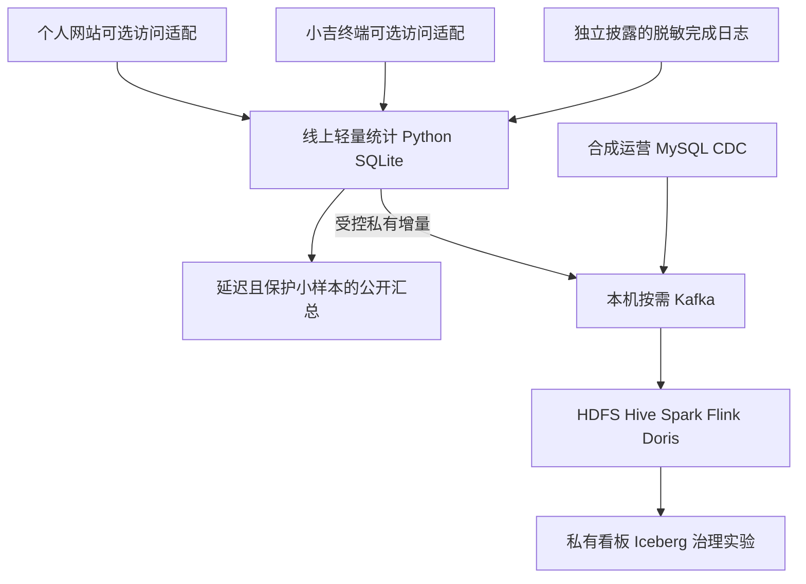

# Snow Statistics 数据开发学习手册

> PowerShell 示例从克隆后的仓库根目录运行。标注为历史的命令和 `runtime/real/operator/` 记录依赖当时的私有环境。新的合成复现按 [README](../../README.md) 与 [分阶段运行手册](../runbook.md) 操作。

这是一套围绕你现有个人网站和小吉终端编写的操作型教材。它解释业务逻辑、系统搭建、接入、使用、数据口径、SQL/Java、维度建模、恢复、优化和面试表达。先理解小样本和工程边界，再逐步启动本机数仓。无需购买多台物理服务器，也不需要每天让所有组件常驻。

初版日期：2026-09-13；最新校准：2026-10-14（Asia/Hong_Kong）。文档只使用源码、契约、合成例子和不含行数据的技术回执，没有把真实用户原始数据复制到本文件夹。阅读这些文档不需要启动服务。文件中的命令需要按注明环境和前置条件执行；并非所有命令都是只读。

## 先看当前状态

两站的采集告知、隐私设置和公开统计已经上线；本机数仓按需运行，关闭电脑不会停掉网站、聊天或轻量统计。真实同步、恢复、离线模型、Doris、私有看板、DIM、Hive、Iceberg及有限表级血缘均有对应实际证据，最新事实与尚未测得的指标见[项目状态](../status.md)。

小吉终端的产品宣传不包含统计功能。宣传录屏、剪辑和发布不影响本项目的学习与工程交付；面试介绍仍可使用本手册的合成例子和技术证据。生产自然流量P95需要真实样本，不能用历史积压或合成数据充数。

第一次使用先按下方阅读路线学习，再看章节目录。最后的历史验收沿革留给查版本、排障和核对实验边界时使用。

## 两条业务线与三个模式

完整模式包含轻量服务和按需实验，轻量模式保留基础统计，关闭模式停止新增采集并保留明确归档或移除页面。业务产品不依赖Snow_Statistics checkout、Kafka、Doris或本机在线。访问统计需要用户同意；服务质量完成日志独立告知。公开内容与内部精确数据有不同披露边界。

## 第一次阅读怎么走

- 只想先跑起来：01、02、11、32、36。用合成小样本，不开VM。
- 想理解产品接入：03–10、13、31。重点看同意生命周期、独立质量日志和公开状态。
- 准备数据开发面试：14–29、33、35。挑可独立解释和复现的模块，附证据。
- 兼顾数据分析面试：03、19–22、32、34。重点看粒度、分母、观察窗口和偏差。
- 准備长期维护或退出：12、25、30、36。先看资源、备份和清理边界。
- 完整学习路线：按01–38顺序，每章完成练习并写一份操作复盘。

## 你会看到的写法

2026-09-19补齐的完整操作路线：新电脑按[第11章](11-PowerShellPythonNodeJava基础环境.md)安装宿主工具，再按[第12章](12-VMware网络资源与日常启停.md)逐台建立VM、Docker、源码与Python环境；已有环境直接从[第13章](13-真实数据按需同步与观察完整性.md)核对配置和受控同步。每天正常停机与恢复看[第24章](24-Flink水位线Checkpoint与迟到修正.md)，离线计算、清理、聚合发布和到期后读取看[第30章](30-日常运维备份精简与移除.md)，命令定位卡见[第36章](36-常用命令索引与执行位置.md)。这些章节区分代码/合成测试已验证与正式整链路仍需实际回执，不把工具存在当成引擎验收。**当前先看第13／36章的10月13日恢复说明；旧 storage V3、固定 closed-day V1 的历史命令不适用于已过期的 epoch。新窗口继续通过公共入口执行源身份、生命周期和实际存储检查，不能复制旧成功标记。** 私有控制器也不是下载公共仓库就自带的通用产品，迁移电脑需要重新建立受信任配置和审阅范围。

每个正文都解释“为什么”和“怎么做”，提供图或流程、步骤/推导、预期结果、故障边界、练习答案和对照源码。源码链接指向本机当前项目绝对路径；章节之间使用相对链接，整体移动文件夹仍可阅读正文。迁移电脑后源码链接需要按新仓库位置调整。

标注PowerShell的代码在Windows运行，sh/bash在指定Linux VM运行，SQL片段先确认引擎和表是否存在，Python教学脚本优先使用内存库或新的runtime路径。示例run ID只是例子，重复实验应换新ID。不要将私钥、令牌、.env、真实事件、数据库或Checkpoint放进学习文件夹或Git。

## 章节目录

- [01-从真实业务理解整个项目](01-从真实业务理解整个项目.md)
- [02-三种运行模式与解耦边界](02-三种运行模式与解耦边界.md)
- [03-指标粒度口径与手算方法](03-指标粒度口径与手算方法.md)
- [04-事件契约时间与来源隔离](04-事件契约时间与来源隔离.md)
- [05-同意撤销跨站归因与可见告知](05-同意撤销跨站归因与可见告知.md)
- [06-轻量服务SQLite与WAL](06-轻量服务SQLite与WAL.md)
- [07-幂等至少一次与事务提交](07-幂等至少一次与事务提交.md)
- [08-公开延迟汇总与小样本保护](08-公开延迟汇总与小样本保护.md)
- [09-线上部署组件与安全启动顺序](09-线上部署组件与安全启动顺序.md)
- [10-两个产品接入与日志质量链路](10-两个产品接入与日志质量链路.md)
- [11-PowerShellPythonNodeJava基础环境](11-PowerShellPythonNodeJava基础环境.md)
- [12-VMware网络资源与日常启停](12-VMware网络资源与日常启停.md)
- [13-真实数据按需同步与观察完整性](13-真实数据按需同步与观察完整性.md)
- [14-Kafka消息分区位点与重放](14-Kafka消息分区位点与重放.md)
- [15-运营模拟器MySQL与CDC](15-运营模拟器MySQL与CDC.md)
- [16-ODS归档HDFS与不可变清单](16-ODS归档HDFS与不可变清单.md)
- [17-SparkYARNHive与离线分层](17-SparkYARNHive与离线分层.md)
- [18-DWD去重隔离与SQL窗口](18-DWD去重隔离与SQL窗口.md)
- [19-维度建模与SCD2历史归属](19-维度建模与SCD2历史归属.md)
- [20-工单轮次累积快照与每日快照](20-工单轮次累积快照与每日快照.md)
- [21-会话留存与观察窗口](21-会话留存与观察窗口.md)
- [22-渠道漏斗与最近有效入口归因](22-渠道漏斗与最近有效入口归因.md)
- [23-Doris结果发布与看板一致性](23-Doris结果发布与看板一致性.md)
- [24-Flink水位线Checkpoint与迟到修正](24-Flink水位线Checkpoint与迟到修正.md)
- [25-Airflow调度补数与失败恢复](25-Airflow调度补数与失败恢复.md)
- [26-数据质量门禁与表级血缘](26-数据质量门禁与表级血缘.md)
- [27-Iceberg快照演进与文件维护](27-Iceberg快照演进与文件维护.md)
- [28-Spark优化实验与诚实解读性能](28-Spark优化实验与诚实解读性能.md)
- [29-KafkaZooKeeper与HDFS故障专题](29-KafkaZooKeeper与HDFS故障专题.md)
- [30-日常运维备份精简与移除](30-日常运维备份精简与移除.md)
- [31-测试候选发布与视频前验收](31-测试候选发布与视频前验收.md)
- [32-SQL入门窗口函数与完整练习](32-SQL入门窗口函数与完整练习.md)
- [33-JavaFlink代码阅读与面试基础](33-JavaFlink代码阅读与面试基础.md)
- [34-数据分析问题实验设计与局限](34-数据分析问题实验设计与局限.md)
- [35-面试讲解简历表述与追问答案](35-面试讲解简历表述与追问答案.md)
- [36-常用命令索引与执行位置](36-常用命令索引与执行位置.md)
- [37-术语表与容易混淆的概念](37-术语表与容易混淆的概念.md)
- [38-学习路线复现清单与操作复盘](38-学习路线复现清单与操作复盘.md)

## 一次成功操作至少留下四样东西

记录输入身份与数据来源、代码/引擎/资源条件、输出与检查结果、仍未验证的边界。结果文件存在不等于成功发布；一张截图不等于完整验收。可以使用[操作复盘模板](38-学习路线复现清单与操作复盘.md)建立自己的实验笔记。

## 文档质量记录

本书的生成与链接检查记录见[99-编写校验记录](99-编写校验记录.md)。该记录只证明教材文件和所述本地示例检查，不代替生产发布收据，也不改变任何业务数据。

## 历史：9月19日13:37独立公网关闭状态验收

2026-09-19 13:37香港，协调者在用户明确授权后完成独立stats Tunnel与域名接入，并实际验证https://stats.xiaob.dev：公开v1/v2为200、archived、no-store；private events/status、health/docs/openapi及根路径均404；两个业务Origin预检200、陌生Origin400。collector仍off，日志服务仍inactive。公网关闭状态的路由边界已通过，不代表正式采集已经开启，也不替代业务产品的人工候选晋级。

最新教学状态和证据范围分别见[第24章恢复](24-Flink水位线Checkpoint与迟到修正.md)、[第31章发布验收](31-测试候选发布与视频前验收.md)及[第99章静态校验](99-编写校验记录.md)。

历史日志切流后复核时间为 **10:14:23 UTC / 18:14:23香港**：当时两个服务active且无重启，8次socket探针最大0.094秒，历史失败未增加，质量ACK仍0。回执文件名的1015不是实际检查时刻。后续18:56:54香港已取得新的真实完成日志端到端通过回执，细节与限度见[第10章](10-两个产品接入与日志质量链路.md)。

## 历史验收沿革（排障时查阅）

下面保留各轮记录产生时的状态和条件。它们不是当前待办清单；其中“最新”“未完成”“VM已关闭”等词均属于相应历史时点，当前结果以本页前面的项目状态入口为准。历史宣传提案也不改变10月14日已明确的宣传范围。

> **2026-10-14真实Hive／Iceberg与最终停止已通过：** 原BCE闭日模型包保持原来源，F8／483在`real-small-1792`（control2048／compute1792／analysis1024 MiB）完成真实Hive登记与独立验证。Spark 3.5.7 `local[1]`应用分别为`local-1791973277761`和`local-1791973714447`，daily／session_daily／retention／funnel四组存在性、计数比较及私下行摘要比较均通过。随后真实Iceberg由两个不同YARN应用`application_1791974201828_0001`、`application_1791974201828_0002`完成执行和独立验证，四组当前／适用历史快照及新增`model_revision`列的校验有效，analysis权威确认通过，见[F8真实Hive与Iceberg技术证据](../evidence/real-hive-lake-f8-r2-20261014.json)。公开只给比较布尔与引擎身份，不发布业务计数、行摘要或可枚举的请求／结果／metadata内容哈希。原聚合2026-10-13香港日期对应的90日到期2027-01-11保持；DIM原始输入仍按其独立七日到期。这不表示Lake表已登记到Hive，也不声称分区演进、MERGE、全图或列级血缘、生产P95。

> **本轮独立收尾与公网回归：** Lake完成后，三个节点分别读回原容器身份、HDFS保持、Hive阶段恢复、阶段租约消失；control精确driver／CID／worker不存在。然后`hive-exit`（9316be）与公共`stop-offline`（d58aa2）分别退出0、数据未删除；独立VM状态（4cbe36）在该观察时点运行数为0，项目约61.99GiB、宿主空闲约194.52GiB，正常72GiB／35GiB边界保持。这是当时的观察，不承诺后续永远关机。UTC10:50:48公网只读回归中，两站和统计页HTTP200，测试的私有路由404，v1／v2契约、旧v1隐藏旁路、no-store及26小时快照检查通过；没有POST、付费模型调用或业务数值记录，也没有新增浏览器交互验收。

> **2026-10-14真实DIM已实际通过：** F8／483来源在显式`real-dim-2560`条件下完成r2，Spark 3.5.7、Python 3.8.10、`local[1]`，实际应用为`local-1791971531318`。`at_event`与`current`两种解析模式的全部字段比较均为true，非空输入验收通过；driver及外层SSH实际退出0，后续独立检查确认本次精确所属容器已不存在，见[F8／r2真实DIM技术证据](../evidence/real-dim-f8-r2-20261014.json)。业务计数和可能被小范围枚举重构的私有结果文件哈希只在私下校验；公开只保留“私有绑定与验证已通过”的布尔结论。这证明本轮真实DIM解析与Join的引擎执行，不会把空历史覆盖补齐：`history_coverage`仍为unknown，unknown也是需正确比较的结果。原输入2026-10-13 04:06:35.627 UTC对应的七日到期2026-10-20 04:06:35.627 UTC保持；没有改写BCE指标、正式产品或公开统计。监控仅有10次宿主采样，54.359秒是SSH窗口时长，不是精确Spark耗时、来宾连续监控或峰值，也不声明VM已关闭。真实Hive／Iceberg和其他结果分别验收。

> **2026-10-14最新源码截点：F8三节点安装已完成。** `f8e3ca8c7823b8736150362ab57316f6a1bca75b`已完成GPG签名、独立验签和推送；push／PR两轮Linux CI共4个作业、54个步骤全部成功，483文件归档与该提交的Git树一致，见[F8签名与CI证据](../evidence/signed-source-f8e3ca8-20261014.json)。analysis、control、compute各自完成prepare、install及独立483文件readback，九个阶段均退出0；每台相对C0F改变16文件，12份冻结writer及依赖保持。配置、恢复元数据和原期限按同一节点的本次fresh prepare与install比较保持，不要求跨节点或与旧历史摘要相等，见[F8三节点安装证据](../evidence/signed-source-install-f8e3ca8-20261014.json)。安装没有启动容器，也不代表引擎验收。原BCE闭日计算、C0F看板／血缘及旧Hive过程继续保留各自实际来源；在源码安装这个时点，DIM引擎尚待实际验收；其后F8／r2已通过，结果见本章最新DIM截点。安装后的全VM关闭是当时观察，后续已进入新的启动窗口，不能作为当前停机声明。

> **历史容量截点：2304前置失败，当时2560待实测。** 已完成的2304 VMX配置与单机无引擎MemTotal2269148KiB／MemAvailable1814740KiB是较早的有限采样。后来的实际CLI在`resource_preflight`报`Analysis guest is too small`，Spark尚未启动，见[2304实际前置失败](../evidence/real-dim-preflight-2304-20261014.json)。不能由旧采样推断该点最低余量或唯一失败原因。新显式`real-dim-2560`为control2048／compute1792／analysis2560MiB、冷态后备6400MiB，另保留128MiB写入预算和每台256MiB启动预留；新VMX、同一次CLI资源准入、DIM引擎和精确收尾仍待实测。2048MiB可见总内存、1536MiB实际可用内存及72／71.75／35／4边界没有降低；原2304、默认和旧Hive/Lake条件保留。

> **C0F历史安装截点（2026-10-14，F8之前）：** 新提交`c0f542cdc7c24610d6922d8748cd17bb0390a148`已签名、推送并通过push/PR两轮Linux CI；完整477文件归档与Git树匹配。analysis、control、compute已经分别完成prepare、source install和独立477文件读回；每台相对BCE改变27文件，12份冻结writer、配置、原恢复元数据和期限保持，见[c0f三节点安装证据](../evidence/signed-source-install-c0f542c-20261014.json)。源码安装期间没有启动容器，引擎成绩另以其实际运行来源判断。最初R2 prepare因已知fixture目录而拒绝，发生在源码替换前，原失败及旧release保留。R3只读取四个real epoch的恢复JSON，已知fixture只检查普通目录存在，原期限不改；新传输复用同哈希文件，不覆盖已上传旧文件。[项目当前状态](../status.md)按新的实际阶段继续更新。

> **闭日与Doris的实际范围：** 原BCE来源已经完成daily、behavior、validate、私有成对发布、stage-release及三项journal COMPLETE，见[BCE闭日技术证据](../evidence/real-closedday-20261013-bce1289.json)。随后独立Doris发布进程退出0，publisher自身的SQL整数读回一致，技术结果元数据读取也成功，见[Doris技术证据](../evidence/real-closedday-doris-20261014.json)。这里没有新增一次独立SQL查询，也没有验收Doris行为表、浏览器数据源或生产P95；小样本业务值仍不公开，覆盖缺口和D1/D7成熟期继续单独判断。

> **2026-10-14私有UI实际完成：** c0f来源在有限loopback窗口显示四个页签及对应表格，日期、cutoff、分母、留存解释、会话30分钟和漏斗30分钟文案通过实际DOM检查，未读取或导出私有业务数值，见[实际私有看板证据](../evidence/real-private-view-20261014.json)。配置权限从0664改为0600，字节与owner保持。UI外层退出0、900秒timeout子进程退出124，实际清理后无活成员且8502监听消失；转发外层退出0、SSH子进程退出1，两类退出原样保留。60秒租约跨界后的浏览器刷新及个别D1/D7状态没有独立观察，仍为未验证。这里展示原BCE闭日包，不证明新的DIM Join或独立Doris SQL。

> **2026-10-14有限真实血缘已读回：** 原闭日daily、behavior、publish三任务的六条START/COMPLETE元数据单独投递并获ACK；旧八条fixture元数据排除，后端三任务均为COMPLETED、输入输出身份匹配，有限图非空，见[实际闭日Marquez证据](../evidence/real-closedday-marquez-20261014.json)。六条ACK只属于该子集，06:28:14 UTC（香港14:28:14）的旧后端证据仍保留ACK尚未导回的历史false；随后06:45:27 UTC（香港14:45:27），C0F来源已将六条闭日ACK导回control原journal，原14条元数据身份保持，八条fixture仍未ACK，见[原journal ACK导回证据](../evidence/real-closedday-marquez-control-ack-20261014.json)。四节点三边是本次观察，不宣称整图完整、全部历史边或列级血缘；没有读取业务行。原BCE模型与c0f投递工具来源分别记录。

> **DIM输入边界继续保留：** 私有看板最初缺Streamlit的失败、锁定lab依赖补齐及配置权限拒绝的历史过程保留。Spark镜像和公开维度文件已实际拉取/读回，连续覆盖仍为空，不能补成完整历史；真实DIM事实Join已取得上述F8／r2独立引擎回执；后续真实Hive/Iceberg也已取得页首所列的独立引擎回执，原历史覆盖仍不补齐。

> **analysis磁盘维护已完成：** 全VM关闭时虚拟盘29→34GiB，首次来宾启动已经自动扩大根分区和ext4；后续检查通过，没有手工重复增长。分区身份及其他分区保持，原数据和期限不改。临时冷维护预算已恢复72GiB，日常71.75GiB停止线、35GiB宿主空闲磁盘和4GiB可用RAM不变，见[analysis扩盘证据](../evidence/analysis-disk-growth-20261014.json)。容量、源码安装与引擎验收分别记录。

> **当前校时事实与边界（2026-10-14）：** 用户批准后，在全部项目VM及原Kafka停止的条件下，管理员已备份必要配置，仅把本机peer从`time.windows.com,0x9`切换到`ntp.aliyun.com,0x9`并完成一次resync；更新和同步均退出0。首次读回为Leap0、Stratum3、LastSyncError0，有限NTP偏移约1.8–2.6毫秒；后续导出又读到stale-time错误2，两种状态都保留，不承诺持续同步或毫秒绝对UTC准确。未修改原时钟门禁、事件UTC、accepted_at或七日保留期，见[实际校时证据](../evidence/host-clock-alignment-20261014.json)、[第12章](12-VMware网络资源与日常启停.md)。原完整protected操作区间的clock_proof已实际通过；单独HTTP探测的更窄区间仍保留约0.10秒正文时间超前，不添加等待凑通过。后续前缀诊断指向源末端已推进，校时和该诊断本身不完成闭日登记、不授予许可，也不代表模型或DIM2304已验收。

> **历史文档签名截点（1b910a2）：** `1b910a23c8a135f042e32f43b7664ed9f534e885`已签名并推送，push/PR两轮CI全部作业及步骤通过。该次是验收文档提交，当时三节点引擎安装来源仍为BCE463；不把文档CI当新VM配置、模型、DIM或引擎验收。[项目状态记录](../status.md)与本书历史GPG等待截点分开保留。

> **BCE三节点安装历史截点：** bce1289已完成签名、双CI全部4作业54步骤及三节点463文件实际安装读回，每节点相对fa057fe变化15文件；12冻结writer、依赖、配置及受保护恢复元数据不变，见[BCE签名与CI](../evidence/signed-source-bce1289-20261013.json)、[BCE三节点安装](../evidence/signed-source-install-bce1289-20261013.json)。PID512修复和公共DIM模块已部署；V19实际结果与未完成的真实报表在下文分别列明。

> V18在实际fa057fe来源下，由两个不同Spark 3.5.7 local[1]应用完成Hive登记与独立读回，四组6/6/2/3行及摘要一致，见[V18合成Hive验收](../evidence/hive-catalog-v18-20261013.json)。旧`lake20261013`的native-thread失败仍保留，不能唯一归因于PID。随后新`lake20261014r1`/V19已在BCE来源下实际通过两个不同Spark 3.5.7 YARN应用的Iceberg执行、独立验证与analysis权威确认，四组当前/历史快照读回一致，见[V19合成Iceberg实际验收](../evidence/iceberg-catalog-v19-20261014.json)。这是合成聚合夹具，未读取生产事件；组级行摘要未独立导出，证据为固定输入/回执哈希链与实际等值校验。原2026-12-14聚合到期不变，旧partial不覆盖。

> V19整轮保存56份完整资源样本，采样OOM计数均为0；另两次精确容器PID观察仅留下10/11条样本，原计划180条均未完成并保留FileNotFoundError。采到的最高PID为295（上限512）；它不是连续峰值，未采到的时段不能推断没有OOM或其他资源事件。实际引擎完成与不完整监控分别判断，不用新成功改写旧失败原因。

> **V19后、闭日模型完成前的历史公共DIM截点：** 公共DIM在宿主由正式产品公开目录生成3个版本/87条目录项的独立metadata，未读取真实事实；连续覆盖为空、小吉实际切流时间未知，观察时刻不冒充业务生效时间，见目录输入与边界（历史本机记录）。此前25项新测试/36项相关回归及4版本/4覆盖段/12维度行合成产物保留，真实DIM与事实Join仍待独立验收。该历史截点香港午夜已过，真实10月13日闭日当时仍须新鲜源、同前缀ACK、原permit、计算对账和发布回执；不填伪造成熟留存或生产P95。

> **历史恢复沿革（V18开始前的原时点）：** 两站接入、同意撤销及线上轻量统计已有正式验收；本机关机不影响既有线上架构。新 `real-prod-04` 已完成实际同步、同一接收前缀的归档／Doris／线上SQLite整数对账、VM软关重启后的原Checkpoint恢复与恢复后对账，以及ODS／HDFS双副本／Kafka确认的独立读回。writer已实际暂停，数据保留；随后统一离线入口也完成实测启停。13:52香港的VM为0、项目约59.25GiB和宿主空闲约191.50GiB是当时的停点，不能代表后续安装、扩盘及新验收期间的运行状态。V12的Hive阶段切换与清理已实际通过，登记随后在control RPC失败；V13新增诊断又因SSH默认工作目录与包装器要求不符，在节点门禁处失败，未定位V12原始Spark异常。两轮失败均已自动收尾并确认三VM全关，数据未删除；这些是各自收尾时点。随后V14实际登记取得Snappy原生库映射失败的诊断；固定镜像内旧／新配置对照已通过，新修复以7173a00签名并实际安装三节点。V15新鲜范围检查和hive-enter实际通过；登记期间analysis可用内存采样降至127 MiB，低于128 MiB门槛，监控器触发中断。三个Spark清理子请求退出0，但整轮登记未验收；自动收尾已读回三VM全关、未删除数据。后续2434ab6已实际安装三节点447文件；香港22:06完成停机状态下analysis768→1024 MiB配置读回，22:11来宾MemTotal为983516 KiB、可用385 MiB，128 MiB门槛保持。V16随后hive-enter成功，但hive-register在宿主前置检查失败，资源samples为空且未调用登记driver，具体触发约束没有留存；自动收尾和独立VM读回均为全关，数据保留，见[V16前置检查失败](../evidence/hive-host-prerequisite-20261013.json)。V17随后在hive-enter之前的analysis暂停保护检查超时，退出1、complete=false、资源samples为0，未进入引擎切换；本轮未由控制器自动收尾，根代理另外执行公共stop-offline并独立读回三VM为0，数据保留。香港22:36的同一公开guard有界实测在26.706秒返回成功，超过旧20秒限制；只扩大analysis guard至70秒的修复已通过193项测试、4项跳过和Ruff，普通probe仍20秒。随后修复以fa057fe完成GPG签名、双轮CI和三节点452文件安装读回；analysis guard70秒已经部署，其余probe20秒不变。V18的新引擎验收仍待实际结果，不能把一次guard通过或源码安装当成Hive或Iceberg通过，见[V17超时与实际核验](../evidence/hive-guard-timeout-20261013.json)。见[V15资源中断证据](../evidence/hive-analysis-reserve-20261013.json)；独立Hive读回和Iceberg仍待验收。香港业务日期2026-10-13最早于10月14日00:00结束；不能拿接收日期替代业务闭日，本次不是闭日报表或成熟D1/D7留存验收。阶段证据与解释见[第17章](17-SparkYARNHive与离线分层.md)和[第99章](99-编写校验记录.md)。

> **1024 MiB离线容量历史截点：** 用户允许适当扩容并记录操作，本项目文件上限已从 64 GiB 调整为 **72 GiB**；宿主 **35 GiB 空闲磁盘、4 GiB 可用 RAM** 不变。离线profile现为control／compute／analysis的 **2048／1792／1024 MiB**，冷态内存后备预算4864 MiB，另留128 MiB作业写入预算。analysis在全VM关闭时已完成配置，仅增加256 MiB；随后来宾可用内存385 MiB是22:11单次采样，不是最低余量或引擎峰值。见配置回读（历史本机记录）、来宾采样（历史本机记录）。下一实时阶段先将关机的analysis改回 **4608 MiB**，其他虚拟机按阶段开启；容量读回不代替引擎验收。control系统盘已实际从18扩到20 GiB，根分区与ext4增长已回读；维护临时82 GiB项目预算已恢复72 GiB，见[扩盘证据](../evidence/control-disk-growth-20261013.json)。内存profile与磁盘容量分开记录，历史 60／64 GiB 实验保留原条件。

> **公开统计卡已正式更新：** 首页与小吉项目页以签名 `e4d9242` 发布，Pages部署及公网桌面/390px手机、中英文、完整统计页、键盘重试均通过。卡片优先展示本应用最近已有公开指标的一日，数值保持同日并标注日期；没有已公开日期时仍显示等待或样本状态。英文长状态完整换行；77项测试与35页构建通过。详见[正式发布证据](../evidence/production-public-cards-20261013.json)。公开门槛没有降低，未公开的null不改成零；此前[候选验收](../evidence/public-card-candidate-20261013.json)保留其当时未发布状态。

> **BCE三节点来源历史截点（后续安装进度见页首）：** `bce12898ea97028519bc589c4c198f1d9b8d581c`，完整463文件归档与签名Git树一致，push `38425953882`／PR `38425959135` 共54步骤成功；三节点完整安装读回见[BCE三节点安装](../evidence/signed-source-install-bce1289-20261013.json)。日期后缀20261013沿用UTC签名日，与香港10月14日安装不冲突。安装回执不代表当前VM开关机状态；V18 Hive成绩继续引用实际fa057fe来源，不能改记为新BCE实测。

> **先处理到期，再处理新数据：** 旧 real-prod-01／02 已退役，`runtime/real/config/production.json` 仍指向旧01，不可直接运行。当前配置是 `runtime/real/config/production-real-prod-04.json`。03首次同步前的比较失败保留，不伪造paused、不提前删除未到期存储；03／04原期限均在10月20日，精确时刻只在私有登记内。下次先核验并清理已到期的登记副本，再开放读取；恢复、复制和重放均不延长原期限。原始数据正文、真实位点和凭据不进入本手册。

> **实际来源与证据时间分开：** 本日较早的真实04恢复、传输和统一离线启停，使用analysis签名基线 `0a548ec1`、control／compute基线 `6c60f761`，叠加各自已记录的工作补丁；这些历史结果保留原来源。随后三节点依次安装50706a8、dc48ff1、7173a00、2434ab6、fa057fe和bce1289；12份冻结writer文件、JAR和原登记不随源码替换改变。V11的阶段切换通过、清理完成消息后非零退出仍保留为失败；退出修复经过独立Linux合成管道测试和新CI，V12清理同时通过完成帧和退出码检查，但登记仍失败，不能借用清理结果声明后续Hive／Iceberg通过。V13是私有诊断包装器自身失败；V14通过默认SSH目录检查后取得实际Snappy映射错误，原失败保留。7173a00引入且后续fa057fe/BCE保留已验证的有界原生库临时目录修复，以及实际发布血缘的自动记录；后者仍须实际成功发布后才有成功血缘，不能由代码安装推断。历史私有storage V3/V4、closed-day V1的日期和epoch固定，不直接套用到04。`real_prefix`不连接引擎、不读取事件、不签发许可，其校验结果不能代替实际后端读回。

> **历史待办截点（V18实际结果及当前待办见页首）：** 本轮04有限前缀的恢复与传输闭环已通过，[脱敏证据](../evidence/real-recovery-20261013.json)记录实际范围。此前通用offline入口因03未paused拒绝；HDFS落地先由独立限范围流程完成，随后新的显式兼容入口也通过三机安装及实际启动、状态和停止验收，见[新入口证据](../evidence/offline-followup-20261013.json)。两者都不代替闭日模型计算。下一步先完成闭日运行范围准备，日期自然结束后再计算；不使用未来cutoff。真实闭日、Hive／Iceberg／血缘、成熟留存和生产P95继续分别验收，详见[第99章](99-编写校验记录.md)。

## 上线历史与实验证据：保留当时版本和条件

| 范围 | 历史验收记录；本次恢复状态以页首为准 |
|---|---|
| 轻量统计与实验数仓 | 本地实现和合成验收已有证据，具体条件分章说明 |
| 浏览器同意、撤销、告知及CSP | 隔离候选及正式浏览器验收通过；分别同意、跨标签撤销、移动端与公开接口隔离有实际回执 |
| 个人站正式 | main `cf3d2fb`，保留并行新增内容；Pages `765c7e23`成功，两个生产统计开关true，首次告知/拒绝/移动端/中英文等正式浏览器验收通过 |
| 小吉终端正式 | blue `65fa0d0` 已人工晋级并通过新版公网 Chrome 与 GET 回归；green `0388b78` 停止保留回滚；源码默认 off，正式配置开启但采集仍需用户同意 |
| 本次正式统计 | 独立入口与 collector lite 已启用；实际浏览器行为已接收、归因和聚合，撤销后回归通过。18:56:54香港真实完成日志从读取器投递到collector、请求去重及基础聚合的只读端到端验收通过；读取器修复前的历史失败保留，有限样例不代表全部请求零丢失 |
| 本机真实数据分析 | 三台已分别安装6c60f761；real-small-1792下land、stage-compute、Spark/YARN daily、行为包、发布与transfer均有实际回执；固定真实闭日候选在sync阶段失败并已安全收尾，未生成闭日报表。该轮合成与真实证据分开；自然生产闭日、Iceberg和物理HA仍按独立证据判断 |
| 私有读取通路 | 专属账户与独立 reader token 已验证；只允许服务器回环8100，无Shell/SFTP。正式VM按需同步另有源身份、生命周期及截止位点验收，不能由账号可登录替代 |
| 宣传视频 | 最新录制版本固定为 `65fa0d0`；技术回归通过，可由原宣传任务按更新移交包继续。用户录制真实对白，剪辑、成品审阅和最终账号发布仍待该任务落实 |

线上独立轻量服务与两业务产品不依赖本机VM。崩溃后 **13:21:31.552702 UTC（香港21:21:31）** 的独立只读复核已通过：collector lite、reader/forwarder正常，无新增failure/gap/capacity指标，公开v1/v2、no-store、pending/null与私有404边界通过；未POST、修改生产、调用模型或导出事件行/计数。这是有限时点的线上证据，不证明本机guest恢复或全部请求覆盖。 [12:49线上只读观察](../evidence/production-observation-20260919.json)另保留为故障前历史观察；最新回执时间与静态校准范围见[第99章](99-编写校验记录.md)。

这张表是时间快照。后续协调者可以按最终发布收据更新它，但不得把历史合成实验改写为真实生产压测。代码变化时，优先读实际契约、对应源码和同版本测试；历史报告保留当时条件。真实 epoch 到期或同步失败后，必须创建新的审阅范围，不能把旧 scope 或旧期限继续使用。
