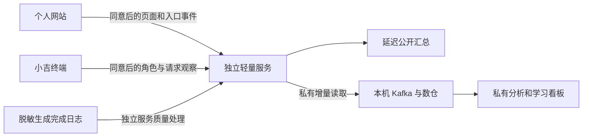

# 01 从真实业务理解整个项目

## 先说项目在解决什么

你已经有个人网站 MyWebsite 和小吉终端 Project_Snow。个人网站展示文章、项目、工具和摄影；小吉终端允许用户选择角色并发起模型对话。运营者希望知道：哪些页面有人看，哪些角色更常被选择，从个人站点击试玩的人是否真正完成对话，已记录的生成请求成功情况如何。

业务问题先于技术栈。Kafka 不是业务目标，Spark 也不是；它们分别承担缓冲/重放、离线计算等工作。项目的一条主线是线上低成本基础统计，另一条是可在本机按需开启的数仓学习实验。真实用户量很小，不能为了使用某个组件强行让产品依赖它。



以一条旅程理解全链路：访客先在个人站同意访问统计，阅读项目介绍，点击试玩。个人站生成一次性的 jump_id，而不是把个人站 anonymous_id 传给小吉。小吉已有自己的有效同意时记录到达。访客提交对话，前端只记录 request_id；服务端完成生成后，独立日志适配器产生可信完成事件。离线作业通过这几个 ID 和时间窗口判断是否转化。

## 你要区分的四类对象

| 对象 | 例子 | 为什么不能混为一谈 |
|---|---|---|
| 用户行为 | 一次页面访问 | 浏览器可断网、可拒绝采集，不等于全量访问 |
| 业务请求 | 一个 request_id | 一次请求可能重试；重发日志不是新请求 |
| 运营实体 | 文章、分类、活动、工单 | 有更新和删除，需要保存历史变化 |
| 实验事件 | 固定种子的合成数据 | 只用来验证模型与性能，不能计入公开真实统计 |

## 第一次上手

在 Windows PowerShell 进入仓库，运行无虚拟机的合成演示：

```powershell
Set-Location -LiteralPath (git rev-parse --show-toplevel)
uv sync --frozen --extra dev --extra lab
uv run snow-stats demo --seed 42 --users 2 --output runtime/learning/demo-01
```

`--users 2` 是两个合成参与者，不是读取两位真实用户。`--seed 42` 固定生成过程；`--output` 是你新建的学习目录。首次选择尚不存在的目录，避免覆盖上一轮成果。本次编写实际以同样 seed/users 运行，输出质量为 raw=28、valid=28、duplicates=0、quarantined=0。这里的28是生成器的事件数，与自然语言中的两人不是同一粒度。

打开生成的 fixture.json 和 model.json，先找 daily、content_scd2、ticket 等顶层内容。不要先试图记住所有组件；先用一句话解释每组输出回答哪个业务问题。

## 验证与排错

看到 `Synthetic artifacts` 说明生成器完成，不代表 Kafka/HDFS/Flink 已运行。若 uv 命令不存在，先看第11章；若输出目录已有历史，换一个后缀，不要删除未知数据。若看板数据来自 Python 正确性基准，演示时就用这个名称，不写成“分布式计算成功”。

## 练习与答案

练习：一个访客拒绝访问统计后成功完成三次对话，应该出现哪些统计？

答案：页面PV、浏览器UV、角色选择、请求关联和渠道归因均不应由该浏览器产生；按已经单独告知的处理方式，服务端三个生成完成日志可以进入服务质量统计。由于完成事件不带匿名标识，不能由这三次完成推算出“一个访客”，也不能把它们补接到某个访问身份。

## 对照源码与项目证据

- [README.md](../../README.md)
- [docs/architecture.md](../architecture.md)
- [src/snow_statistics/simulator.py](../../src/snow_statistics/simulator.py)

[返回学习目录](00-阅读地图与当前状态.md)
