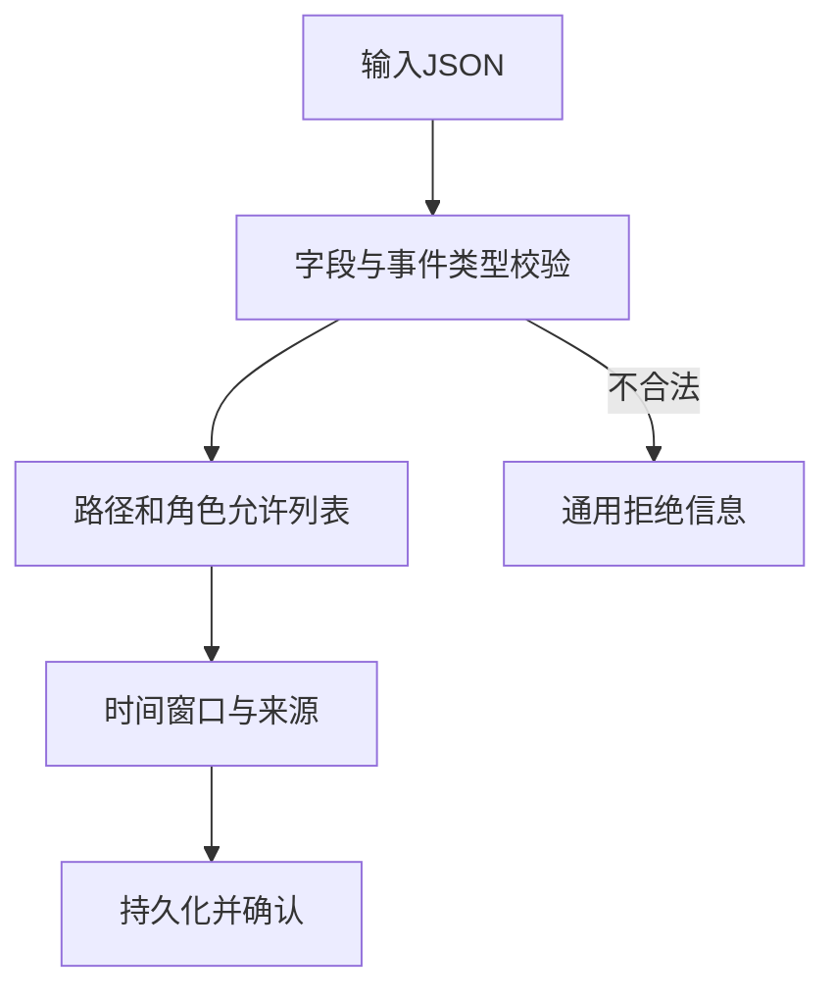

# 04 事件契约、时间与来源隔离

## 事件是双方约定的数据语言

事件v1的核心字段包括schema_version、event_id、app、event_type、occurred_at。不同事件类型有不同白名单；不是给一个任意JSON就让数仓自己猜。page_view带path，character_select带character_id，入口事件带jump_id，请求观察带request_id，可信完成带request_id、character_id、success、elapsed_ms。

服务端完成事件不允许anonymous_id和session_id，客户端也不能自称“我成功了”。采集API只有验证可信server token后才接受request_complete；origin允许列表只能降低误接入，不能证明请求由真实人类发出。



## 四种时间，不要混淆

1. occurred_at：事件在业务上发生的时刻，保存带时区UTC时间。
2. accepted_at：轻量服务成功接受事件的时刻，决定对账的已接收边界。
3. business_date：occurred_at转换为香港日期，用于日指标分组。
4. generated_at／cutoff：某次结果生成时刻和计算使用的数据截止条件。

`event time`通常指第一种时间；它回答“业务何时发生”。`accepted_at`回答“采集服务何时接收”，由采集端生成，复制、重放、恢复时必须保留原值。它也参与数据保留期限；不能因为今天补数就把七日起点改成今天。当前实现先生成接收时间再取得写锁，因此按提交序号前进不保证`accepted_at`逐条递增，详见[第13章](13-真实数据按需同步与观察完整性.md)。

UTC是同一个时刻的统一表示方式，不会自动把各台机器的钟校准。UTC墙钟读数用于事件时刻、日界线、截止和到期判断；机器的钟如果快了21秒，显示成UTC后仍快21秒。业务日则按已约定的香港时区转换，不把Windows的显示时区当指标定义。

`mono`指单调计时，例如Python的`time.monotonic()`：像秒表一样，用前后差计算本次等待或操作耗时，避免墙钟校准时跳动影响超时判断。它的起点不是某个UTC日期，不能写进事件时间、推导业务日期，也不能直接减另一台机器的mono。业务事件时间、接收时间、墙钟和单调计时各有用途，不以一种代替另一种。

| 问题 | 应使用的时间 | 不能据此推出什么 |
|---|---|---|
| 事件属于哪个香港业务日？ | 原`occurred_at`的UTC时刻转`Asia/Hong_Kong` | 接收日不一定等于发生日 |
| 此次计算包含哪个已接收前缀？ | 原`accepted_at`、提交seq及固定cutoff共同校验 | seq不是墙钟水位，不能保证排队请求全部包含 |
| 原始副本何时到期？ | 原保留登记及原`accepted_at`产生的截止 | 复制时间、恢复时间不重新起算七日 |
| 本机请求等待了多久？ | 同一计时域内mono前后差 | 不能据此判断今天是哪一天或跨机器延迟 |
| 两台机器能否比较延迟或闭日？ | 各自UTC墙钟及实际同步、时钟差证据 | guest跟随host不证明host本身准确 |

例如UTC `2026-01-01T16:00:00Z` 对应香港 `2026-01-02 00:00:00`，属于1月2日。Python可直接验证：

```powershell
uv run python -c "from datetime import datetime; from zoneinfo import ZoneInfo; print(datetime.fromisoformat('2026-01-01T16:00:00+00:00').astimezone(ZoneInfo('Asia/Hong_Kong')))"
```

预期输出包含 `2026-01-02 00:00:00+08:00`。不要通过给字符串日期手动加8小时并丢掉时区来实现。

2026-10-14校时前的实际预检中，VM时间位于主机请求区间内，但主机还在使用Local CMOS Clock，没有成功NTP同步记录；对可达源的NTP探测显示本机领先约21.64秒。因此“host和guest差得很少”与“二者UTC准确”是两个检查。这是保留的历史定位，不能改成当时已经同步。

随后管理员按批准范围备份必要配置、切换单一peer并resync一次，均退出0。首次有限偏移约1.8–2.6毫秒且LastSyncError0，后续又出现stale-time错误2；实际执行成功不等于持续准确。原完整protected操作的clock_proof实际通过，但更窄HTTP探测仍有约0.10秒跨机器差异，两个采样区间不能混用，也不能据此宣称毫秒绝对UTC精度。保留原事件UTC、accepted_at及期限；闭日登记、同前缀ACK、模型或DIM验收仍须各自的实际回执。定位、有限校准、复查的八步操作卡见[第12章时钟小节](12-VMware网络资源与日常启停.md#2026-10-14时钟定位有限校准与复查)。

## source不由浏览器自行声明

real／synthetic由受控入口和运行配置确定。开发样例走synthetic独立数据库/目录/主题；公开汇总只读real。浏览器事件v1里没有可随意填写的source字段。这能避免客户端把自己标成受信任来源，也避免测试脚本一不小心污染公开统计。

路径只取pathname并匹配允许列表。例如 `/tools/json/?token=abc` 只可能记录 `/tools/json/`；查询参数不能进入事件。未知页面或非公开角色直接拒收，不能为方便统计而自动接受任意值。

## 自检、故障与练习

查看 `contracts/v1/events.schema.json` 和 `src/snow_statistics/contracts.py`，对照每个事件的required/allowed字段。写一条带chat字段的page_view应失败；写不带时区的occurred_at应失败；客户端完成事件应因权限不足失败。

练习：同一个事件1月1日发生，1月2日接收，为什么1月1日报表补数时仍可能加入它？

答案：业务日期来自发生时间；计算截止边界来自接收时间。只要该次补数的accepted_at cutoff包含它、事件时间也符合窗口，就应该进入1月1日的内部结果。公开快照可能已经冻结，因此内部校正不代表必须改公开历史。

## 对照源码与项目证据

- [contracts/v1/events.schema.json](../../contracts/v1/events.schema.json)
- [src/snow_statistics/contracts.py](../../src/snow_statistics/contracts.py)
- [src/snow_statistics/api.py](../../src/snow_statistics/api.py)
- [src/snow_statistics/store.py：原接收时间与存储](../../src/snow_statistics/store.py)
- [tools/smoke_freshness.py：mono耗时与墙钟漂移检查](../../tools/smoke_freshness.py)
- [2026-10-14历史校时前预检](../evidence/host-clock-precheck-20261014.json)
- [已执行校时与后续error2边界](../evidence/host-clock-alignment-20261014.json)

[返回学习目录](00-阅读地图与当前状态.md)
