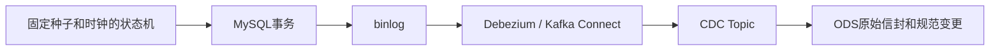

# 15 运营模拟器、MySQL与CDC

## 行为事件与业务表变更不同

点击、访问等事件通常追加后不修改；文章分类、发布状态、工单状态会变化。CDC捕获数据库insert/update/delete，使你能按变化构建历史维度和事实。Python状态机负责生成内容发布、分类变更、渠道活动和工单操作；MySQL保存当前业务状态；Debezium通过binlog输出变更到Kafka。



这些运营实体属于合成学习系统，不是向两个现有产品数据库里硬加实验表。即使后来真实网站有反馈功能，也不能未经新的接入设计就读取真实反馈正文来替代合成工单。

## CDC消息要读什么

before表示变更前记录，after表示变更后记录，op说明操作类型；source和事务元数据描述binlog位置、事务等。snapshot读出的初始记录与后续更新是不同捕获阶段。delete的业务意义要保留，Kafka tombstone是消息清理机制的一部分，不能再把它重复计算成第二次业务删除。

在ODS保留完整原始信封用于重建，同时产生经过白名单与类型验证的规范变更供模型处理。只有规范结果不够排障；只存原始JSON又会让每个下游自己猜字段。两者承担不同职责。

## 操作入口

三类工具的副作用不同，先分清再动手：

| 工具 | 实际行为 | 是否支持只读 `--help` |
|---|---|---|
| `tools/mysql_simulator.py` | 向固定合成库 `snow_ops` 事务写入；同run/version已应用时跳过 | 支持，argparse在连接前处理帮助 |
| `tools/register_cdc.py` | 创建/更新CDC账号权限并向Connect执行PUT，名称固定 `snow-synthetic-ops` | **不支持**；给它传 `--help` 仍会执行正文 |
| `tools/consume_cdc.py` | 拉取一批CDC、写文件并提交固定group位点 | 支持，但正常运行会提交；它不是无副作用探针 |
| `tools/land_kafka.py` | 按独立lane捕获完整原始信封，再分阶段落地、确认 | 支持；本章真实捕获采用该入口 |

```powershell
uv run --extra lab python tools/mysql_simulator.py --help
uv run --extra lab python tools/consume_cdc.py --help
Get-Content -LiteralPath tools/register_cdc.py
```

最后一条只读源码，不执行它。`consume_cdc.py`固定使用group `snow-cdc-archive-v1`；仅更换 `--output` 不会得到独立消费进度，所以不作为本章新学习目录的采集入口。它的规范化输出也不等于完整原始CDC归档。不要把生产MySQL地址、业务账号或真实反馈表交给模拟器。Connect配置响应可能含凭据，不输出完整配置JSON。

## 完整本地实操：事务重试、CDC删除与tombstone

先在 **Windows PowerShell、Snow_Statistics仓库目录**完成这条不需要VM的路线。前置条件为第11章Python环境。输入来自固定 `generate(seed=42, users=2)`，SQLite仅用于演示“去重标记与业务更新在同一事务”的原理；CDC解析调用实际 `snow_statistics.landing.normalize`。这不是MySQL binlog、Debezium或Kafka引擎实测。

1. 在文件管理器中创建或打开仓库内已有的 `runtime/learning` 文件夹，把下面完整代码保存为其中的 `cdc-transactions-lesson.py`。不修改正式采集器、业务表或已有合成MySQL。
2. 执行以下命令。独立目录中会生成合成fixture、教学SQLite、原始信封、规范变更与结果；不要将真实输入替换进去。

```powershell
Set-Location -LiteralPath (git rev-parse --show-toplevel)
$cdcLesson = 'runtime/learning/cdc-transactions-' + [guid]::NewGuid().ToString('N')
& ./.venv/Scripts/python.exe runtime/learning/cdc-transactions-lesson.py --output $cdcLesson
if ($LASTEXITCODE -ne 0) { throw 'CDC练习失败，保留目录排查' }
Get-Content -LiteralPath (Join-Path $cdcLesson 'result.json')
Get-ChildItem -LiteralPath $cdcLesson | Select-Object Name,Length
```

3. 手算：内容4次变化＋活动1次＋两张工单各5次＝**15次业务变更**。首次应用15次；同run重放应用0次。最后内容1条、活动1条、工单2条。
4. 教学信封每次业务变更发一条，删除后另外发一个tombstone，所以原始消息**16条＝15条规范变更＋1条tombstone**，规范删除为1。`rollback_preserved_state=true`表示事务内已写入的去重标记和业务删除一起回滚。
5. 检查两个 `*_engine_tested` 都为false；程序结束关闭SQLite，不需要停任何服务。再次运行换新目录，比较结果，不覆盖旧证据。

教学信封数量不等于历史真实Debezium数量。实际 `mysql_simulator.py` 为保留有效删除时刻，会在删除事务内先UPDATE版本/时间再DELETE；snapshot、这些额外binlog记录和历史重复操作也会改变消息数。历史[CDC回执](../evidence/cdc-receipt.json)记录19条规范记录，其中15条带事务元数据，不能用它要求本地教学样例也输出19。下面代码是在提交后构造合成信封，**没有实现可靠outbox**：如果进程在SQLite提交后、构造信封前崩溃，它不能自动补发；生产Debezium读取持久binlog是另一个机制。

```python
"""Synthetic SQLite transaction exercise plus the actual CDC normalizer; no MySQL/Kafka."""
import argparse
import base64
import json
import sqlite3
from collections import Counter
from pathlib import Path

from snow_statistics.landing import normalize
from snow_statistics.publication import canonical
from snow_statistics.simulator import generate

parser = argparse.ArgumentParser()
parser.add_argument('--output', type=Path, required=True)
args = parser.parse_args()
args.output.mkdir(parents=True, exist_ok=False)
fixture = generate(seed=42, users=2)
assert fixture['source'] == 'synthetic'
(args.output/'fixture.json').write_bytes(canonical(fixture) + b'\n')
database = sqlite3.connect(args.output/'lesson.sqlite')
database.executescript('''
CREATE TABLE applied(run_id TEXT, version INTEGER, PRIMARY KEY(run_id, version));
CREATE TABLE entities(table_name TEXT, entity_id TEXT, row_json TEXT,
                      PRIMARY KEY(table_name, entity_id));
''')
run_id = 'seed-42-users-2-v1'
raw, changes = [], []
offsets = Counter()


def record(table, payload):
    topic = 'snow.synthetic.cdc.snow_ops.' + table
    row = dict(topic=topic, partition=0, offset=offsets[topic], timestamp_ms=0,
               key_b64=None, value_b64=None if payload is None else base64.b64encode(canonical(payload)).decode(),
               headers=[])
    offsets[topic] += 1
    raw.append(row)
    kind, normalized = normalize(row)
    if kind == 'changes':
        changes.append(normalized)


def apply_changes(emit):
    applied = 0
    for change in sorted(fixture['changes'], key=lambda row: (row['at'], row['version'])):
        payload = None
        with database:
            cursor = database.execute('INSERT OR IGNORE INTO applied VALUES (?,?)', (run_id, change['version']))
            if not cursor.rowcount:
                continue
            table, key = change['table'], change['key']
            old = database.execute('SELECT row_json FROM entities WHERE table_name=? AND entity_id=?',
                                   (table, key)).fetchone()
            before = json.loads(old[0]) if old else None
            if change['op'] == 'd':
                assert before is not None
                before.update(version=change['version'], updated_at=change['at'])
                after, operation = None, 'd'
                database.execute('DELETE FROM entities WHERE table_name=? AND entity_id=?', (table, key))
            else:
                after = dict(id=key, **change['after'], version=change['version'], updated_at=change['at'])
                operation = 'c' if before is None else 'u'
                database.execute('INSERT OR REPLACE INTO entities VALUES (?,?,?)', (table, key, json.dumps(after)))
            payload = dict(before=before, after=after, op=operation,
                           source=dict(db='snow_ops', table=table), transaction=dict(id='synthetic-' + str(change['version'])))
        applied += 1
        if emit:
            record(table, payload)
            if operation == 'd':
                record(table, None)
    return applied


first, replay = apply_changes(True), apply_changes(False)
counts = dict(database.execute('SELECT table_name,COUNT(*) FROM entities GROUP BY table_name'))
assert first == 15 and replay == 0 and counts == {'campaigns': 1, 'contents': 1, 'tickets': 2}
try:
    with database:
        database.execute('INSERT INTO applied VALUES (?,?)', ('rollback-probe', 1))
        database.execute('DELETE FROM entities')
        raise RuntimeError('synthetic failure before commit')
except RuntimeError:
    pass
assert database.execute('SELECT COUNT(*) FROM applied WHERE run_id=?', ('rollback-probe',)).fetchone()[0] == 0
assert dict(database.execute('SELECT table_name,COUNT(*) FROM entities GROUP BY table_name')) == counts
database.close()
for name, rows in [('raw.jsonl', raw), ('changes.jsonl', changes)]:
    (args.output/name).write_bytes(b''.join(canonical(row) + b'\n' for row in rows))
result = dict(input_origin='synthetic fixtures', mysql_engine_tested=False, debezium_engine_tested=False,
              business_changes=first, replay_applied=replay, current_entities=counts, raw_messages=len(raw),
              normalized_changes=len(changes), tombstones=sum(row['value_b64'] is None for row in raw),
              normalized_deletes=sum(row['op'] == 'd' for row in changes), rollback_preserved_state=True)
assert result['raw_messages'] == 16 and result['normalized_changes'] == 15 and result['tombstones'] == 1
(args.output/'result.json').write_text(json.dumps(result, indent=2) + '\n', encoding='utf-8')
print(json.dumps(result))
```

## 已有专用合成MySQL与Connect的实际操作路线

这部分命令会启动实验服务、写合成表及配置Connect。**本次补写只核验源码和历史证据，没有运行这些VM命令。** 先完成本地练习，再在独占该合成摄取阶段时使用；不与其他离线Hive/Iceberg窗口同时启动。

### 1. 核对环境与资源

Windows使用第12章status检查；只有全部VM正常停止后，才可以把control配置为已存在的 `batch` profile（4096 MiB）并单独启动。配置档名称虽叫batch，这里只用其control内存设置，**不启动Hadoop**。Kafka、MySQL、Connect容器上限合计约2.75 GiB，还需Linux与缓存余量，当前2048 MiB的离线control配置不能直接照搬来同时运行这三个服务。项目72 GiB、宿主35 GiB空盘及4 GiB可用RAM边界照常检查。

```powershell
# Windows仓库根目录；先确认所有VM已正常关闭
& ./.venv/Scripts/python.exe tools/vmware_lab.py status
& ./.venv/Scripts/python.exe tools/vmware_lab.py configure --node snow-control --profile batch
if ($LASTEXITCODE -ne 0) { throw '配置失败，停止' }
& ./.venv/Scripts/python.exe tools/vmware_lab.py start --node snow-control --reserve-mib 256
if ($LASTEXITCODE -ne 0) { throw '资源或开机检查失败，停止' }
```

进入 **snow-control Linux VM**，以下工作目录固定为 `/home/snow/Snow_Statistics`。前提是第12章已建立锁定镜像、`.venv`、`lab/.env`及独立合成MySQL卷；数据库为 `snow_ops`，账号为 `snow_simulator`。首次空卷由 `lab/mysql/001-schema.sql` 初始化；已有卷不能通过删除来“重跑初始化”。

```bash
set -euo pipefail
cd /home/snow/Snow_Statistics
set -a
. lab/.env
set +a
sudo docker compose --env-file lab/locks/images.env --env-file lab/.env \
  -f lab/compose.control.yaml up -d kafka mysql connect
timeout 60 sudo docker compose --env-file lab/locks/images.env --env-file lab/.env \
  -f lab/compose.control.yaml exec -T kafka \
  /opt/kafka/bin/kafka-broker-api-versions.sh --bootstrap-server "$CONTROL_IP:9092"
```

上面的API探针失败就停止后续写入；容器Started不等于broker、MySQL和Connect均已就绪。首次Connect启动较慢时查看容器状态，等其有界恢复再重试探针，不反复执行模拟器。

### 2. 明确注册动作，再等待connector真正运行

对于已登记、已核对为本项目合成系统的同一个Connect实例，先只读取status；不存在时才执行注册脚本。以下代码只输出状态，不输出带密码的配置或异常正文。现有connector若失败则退出，不能靠重复PUT覆盖未知配置“修复”。

```bash
.venv/bin/python - <<'PY'
import os, subprocess, time
import httpx
host = os.environ['CONTROL_IP']
url = f'http://{host}:8083/connectors/snow-synthetic-ops/status'
with httpx.Client(timeout=10) as client:
    response = client.get(url)
    if response.status_code == 404:
        # 明确副作用：创建/更新专用账号权限，并PUT合成connector配置。
        subprocess.run(['.venv/bin/python', 'tools/register_cdc.py'], check=True, timeout=60)
    elif response.status_code != 200:
        raise SystemExit(f'Connect status HTTP {response.status_code}; stop before simulation')
    for attempt in range(20):
        response = client.get(url)
        if response.status_code == 200:
            value = response.json()
            connector = value['connector']['state']
            tasks = [item['state'] for item in value.get('tasks', [])]
            if connector == 'RUNNING' and tasks == ['RUNNING']:
                print('synthetic connector and its single task are RUNNING')
                break
            if connector == 'FAILED' or 'FAILED' in tasks:
                raise SystemExit('Synthetic connector failed; inspect private diagnostics')
        time.sleep(2)
    else:
        raise SystemExit('Bounded readiness check expired; no simulation executed')
PY
```

### 3. 写固定小样本，并核对已应用事务

```bash
.venv/bin/python tools/mysql_simulator.py --host "$CONTROL_IP" --seed 42 --users 2
.venv/bin/python - <<'PY'
import json, os
import pymysql
with pymysql.connect(host=os.environ['CONTROL_IP'], user='snow_simulator',
        password=os.environ['LAB_MYSQL_PASSWORD'], database='snow_ops') as db:
    with db.cursor() as cursor:
        cursor.execute('SELECT COUNT(*) FROM applied_transactions WHERE run_id=%s', ('seed-42-users-2-v1',))
        applied = cursor.fetchone()[0]
        assert applied == 15, 'Fixed transaction prefix is incomplete'
        counts = {}
        for table in ('contents', 'campaigns', 'tickets'):
            cursor.execute('SELECT COUNT(*) FROM ' + table)
            counts[table] = cursor.fetchone()[0]
print(json.dumps(dict(input_origin='synthetic fixtures', applied_transactions=applied,
                      current_table_counts=counts)))
PY
```

`run_id`由seed/users组成并固定为 `seed-42-users-2-v1`。重复执行时15个已应用标记让模拟器跳过原事务，可能没有任何新CDC；这是幂等结果，不是采集失效。共享合成库若已有更大实验，当前表行数不保证等于1/1/2；先辨认其输入历史，不删除标记、换seed覆盖旧实验或声称这是全新数据库成绩。

### 4. 捕获完整CDC信封，保存独立学习目录

本项目ODS白名单包含行为主题和三个CDC主题。四个主题必须存在；在专用合成broker里可为没有行为输入的新环境创建空的行为主题，**不创建或读任何real主题**：

```bash
sudo docker compose --env-file lab/locks/images.env --env-file lab/.env \
  -f lab/compose.control.yaml exec -T kafka /opt/kafka/bin/kafka-topics.sh \
  --bootstrap-server "$CONTROL_IP:9092" --create --if-not-exists \
  --topic snow.synthetic.events.v1 --partitions 1 --replication-factor 1
lessonLane="learn-cdc-$(date -u +%Y%m%d%H%M%S)"
lessonDir="runtime/learning/$lessonLane"
test ! -e "$lessonDir"
.venv/bin/python tools/land_kafka.py capture --source synthetic \
  --lane "$lessonLane" --directory "$lessonDir" --max-records 100
```

检查batch manifest中的source为synthetic，`raw=events+changes+tombstones+quarantine`；`changes.jsonl`应只含白名单业务表，`raw.jsonl`保留原始信封及tombstone。capture不提交group；第16章用**同一目录和lane**完成HDFS落地、校验、ack。三个CDC主题尚未就绪、历史已被Kafka保留策略截断或隔离数非零时停止排查，不将旧19条回执作为当前结果代填。新lane的consumer group独立，但主题及MySQL仍是本项目已有合成实例，不是另一个数据库。

### 5. 结束与恢复

确认模拟器和捕获命令已经返回，保存本次源码SHA、lane、输入、输出和退出码。仅当这些服务由本轮启动、没有其他任务使用时，按同一Compose身份执行 `stop connect mysql kafka`，再由Windows的 `tools/vmware_lab.py stop --node snow-control` 软关。保留MySQL/Kafka卷、applied_transactions和学习目录；不执行 `down -v`、删除binlog或全局prune。下次先查看pending是否存在，有则继续原批次；没有新消息时不要为“产生结果”重置group。

## 事务一致的意义

例如发布内容时同时写内容状态和分类关系。如果生成器随机独立输出两条不一致记录，数仓得到的冲突可能来自不合理输入而非模型问题。状态机应保证操作前置状态与业务事务合法：已解决工单重开才新增一轮；被删除内容不继续像正常在售实体一样更新。

固定seed、固定业务时钟使每轮输入可复核。现实世界的所有可能情况并不会因固定种子自动覆盖，必须另外设计分类变更、同时间顺序、重开、更新、删除和重复样例。

## 练习与答案

练习：CDC delete后紧接着tombstone，工单删除事实应增加两条吗？答案：不应。保留两条原始消息及其不同性质，规范业务变化只产生一次删除。质量账本要把tombstone单独列出，这样原始数仍可对账。

排错时先确认binlog/connector状态和实际位点，再检查业务表事务是否提交；不能因为Kafka没立即出现消息就反复执行生成器，制造多次合法但非预期的业务操作。

## 对照源码与项目证据

- [tools/mysql_simulator.py](../../tools/mysql_simulator.py)
- [tools/register_cdc.py](../../tools/register_cdc.py)
- [docs/incremental-ods.md](../incremental-ods.md)

[返回学习目录](00-阅读地图与当前状态.md)
