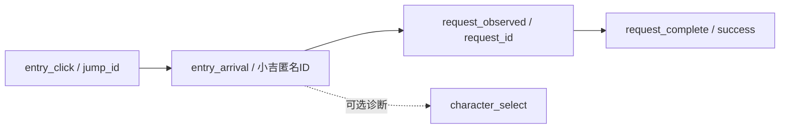

# 22 渠道漏斗与最近有效入口归因

> **2026-10-14真实Hive／Iceberg与最终停止已通过：** 原BCE闭日模型包保持原来源，F8／483在`real-small-1792`（control2048／compute1792／analysis1024 MiB）完成真实Hive登记与独立验证。Spark 3.5.7 `local[1]`应用分别为`local-1791973277761`和`local-1791973714447`，daily／session_daily／retention／funnel四组存在性、计数比较及私下行摘要比较均通过。随后真实Iceberg由两个不同YARN应用`application_1791974201828_0001`、`application_1791974201828_0002`完成执行和独立验证，四组当前／适用历史快照及新增`model_revision`列的校验有效，analysis权威确认通过，见[F8真实Hive与Iceberg技术证据](../evidence/real-hive-lake-f8-r2-20261014.json)。公开只给比较布尔与引擎身份，不发布业务计数、行摘要或可枚举的请求／结果／metadata内容哈希。原聚合2026-10-13香港日期对应的90日到期2027-01-11保持；DIM原始输入仍按其独立七日到期。这不表示Lake表已登记到Hive，也不声称分区演进、MERGE、全图或列级血缘、生产P95。

> **2026-10-14真实DIM已实际通过：** F8／483来源在显式`real-dim-2560`条件下完成r2，Spark 3.5.7、Python 3.8.10、`local[1]`，实际应用为`local-1791971531318`。`at_event`与`current`两种解析模式的全部字段比较均为true，非空输入验收通过；driver及外层SSH实际退出0，后续独立检查确认本次精确所属容器已不存在，见[F8／r2真实DIM技术证据](../evidence/real-dim-f8-r2-20261014.json)。业务计数和可能被小范围枚举重构的私有结果文件哈希只在私下校验；公开只保留“私有绑定与验证已通过”的布尔结论。这证明本轮真实DIM解析与Join的引擎执行，不会把空历史覆盖补齐：`history_coverage`仍为unknown，unknown也是需正确比较的结果。原输入2026-10-13 04:06:35.627 UTC对应的七日到期2026-10-20 04:06:35.627 UTC保持；没有改写BCE指标、正式产品或公开统计。监控仅有10次宿主采样，54.359秒是SSH窗口时长，不是精确Spark耗时、来宾连续监控或峰值，也不声明VM已关闭。真实Hive／Iceberg和其他结果分别验收。

> **C0F历史边界（F8真实DIM之前）：** c0f已经签名、CI通过并在analysis、control、compute分别完成477文件安装和独立读回，见[c0f三节点安装证据](../evidence/signed-source-install-c0f542c-20261014.json)；真实DIM与漏斗事实Join仍待独立引擎验收；不会改变本章最近有效入口的业务规则。[公共目录DIM操作](../public-dimensions.md)提供发生时/当前版本解析，历史覆盖不足返回unknown。V18合成Hive与后续[V19合成Iceberg](../evidence/iceberg-catalog-v19-20261014.json)中的funnel=3行仅是合成报表行数，不能解释成三个真实用户转化或生产归因已验收；真实闭日报表仍单独验证。

## 业务问题

“项目页点了多少次试玩”与“有多少点击最终完成对话”是不同问题。项目主转化要求：点击→有效到达→同应用匿名标识上的request_observed→可信成功完成，整条链路在点击后的30分钟内成立。恰好30分钟有效，超出1毫秒无效。



角色选择是辅助诊断步骤，用户使用默认角色直接成功对话也算转化。不能把“选择角色”强行设为每条转化必经步骤，然后把正常默认角色用户排除。

## 最近一次有效点击

用户10:00从入口A到达，10:10又从入口B到达，10:20成功，则归于B，因为B是窗口内最近一次有效入口。每个点击最多计一次转化。如果10:25再成功且B已经计过，不能为了增加转化数退回A；当前规则是最近点击消费后不回退。

没有浏览器同意时缺少arrival或observed，服务质量完成仍可存在，但该请求没有足够依据做访问归因。不要为了提高漏斗完整率强行把请求按时间相近拼到某个匿名人。

## 为什么有两个ID桥接

跨站jump_id只联系一次入口，不把个人站长期匿名ID带到小吉。小吉anonymous_id关联到达与请求观察；request_id再连接服务端完成。这个设计允许两个应用长期标识独立，也让服务质量事件本身不必携带浏览器身份。

## 动手手算

准备一张四列表：点击时间、到达时间、观察时间、完成时间。检查所有时间单调并位于点击+30分钟内，再从候选入口中选择最近。最后使用已消费jump集合确保一次点击最多转化一次。

```powershell
uv run pytest -q tests/test_behavior.py tests/test_acceptance.py
Get-Content src/snow_statistics/behavior_fixture.py
```

测试和fixture比抽象定义更容易揭示边界：重复完成、恰好边界、晚1毫秒、默认角色、最近入口已消费都要单独验证。只验证一条顺利路径不能说明归因正确。

## 练习与答案

题：10:00点击A，10:10点击B，10:20第一次成功归B；10:21第二次成功时B已消费，A还没消费，应给A算一次吗？答案：不算。规则是对成功选择最近有效点击，再判断其是否已消费，不从未消费点击中挑一个来凑数。否则一个用户频繁聊天会把早先许多点击全部补成转化，夸大渠道效果。

公开页不展示这种细粒度轨迹；漏斗仅在受控本机分析中处理真实数据，演示与面试使用合成样例。

## 对照源码与项目证据

- [src/snow_statistics/behavior.py](../../src/snow_statistics/behavior.py)
- [src/snow_statistics/behavior_fixture.py](../../src/snow_statistics/behavior_fixture.py)
- [tests/test_behavior.py](../../tests/test_behavior.py)

[返回学习目录](00-阅读地图与当前状态.md)


## 上线样例能证明哪一步漏斗

本次生产浏览器观测到了入口点击和目的到达相匹配，目的统计片段也被清除；访问统计的两站同意独立。由于没有发起付费生成，也没有新的成功完成对话，本次只验证入口→到达，不能把它计算成计划中“30分钟内成功对话”的主转化。7条验收事件不应出现在简历里成为业务转化增长证据。

测试采用观察点击后链接、再在另一标签页打开该链接的受控方式，所以自动弹出新标签页尚无这一回执的证明。复盘时写清操作方式，能帮助面试官区分归因标识传递、浏览器交互和业务成功判定这三件事。
