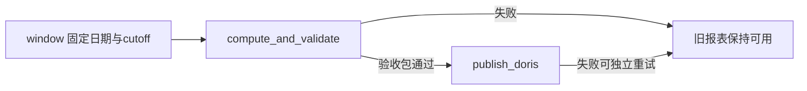

# 25 Airflow调度、补数与失败恢复

## 调度器解决的是依赖和状态

Airflow不会代替Spark计算，也不会让尚未开机的虚拟机自动出现。本项目把“确定统计窗口、计算并验收、发布结果”写成有依赖的任务。上游失败时，下游不能发布半成品；重试保留每次尝试的身份，便于解释一次成功背后经历了什么。



`snow_daily`计算基础日指标；`snow_models`分别计算运营模型和行为模型，再发布私有模型；真实数据专用`snow_real`处于本次正式接入实施范围。不要因为DAG文件已经存在就写“所有真实生产调度已经验收”，必须关联运行收据。

## 先理解三个时间

业务日期是Asia/Hong_Kong日历中的日期。cutoff是允许纳入数据的UTC接收截止时间。调度器开始执行的墙钟时间只是运行时间。同一业务日可以在不同cutoff下重算，晚到数据因而逐渐补齐；相同cutoff的不同内容不能静默互相覆盖。

例如香港1月4日的报表可在1月5日首次计算，1月7日收到一条发生在1月4日的事件后再次校正。报表日期仍是1月4日，发布版本使用新的cutoff。固定cutoff并冻结输入清单，可以判断两次结果差异是否来自代码变化。

## 当前资源约束影响执行方式

历史完整小样本DAG在batch的4/4/2 GiB三VM下计算，随后关闭计算VM，把分析VM切到olap6 GiB发布。Airflow运行在control，使用SequentialExecutor和独立SQLite元数据库，默认只有scheduler，每次执行一个任务。百万规模的2/2/1 GiB测试没有同时开启Hive、Airflow和治理，不能直接替换上述DAG条件。

默认调度为manual且DAG暂停。只有基础设施能够按时工作时，才配置daily、重建调度器并显式unpause；daily表示香港每天03:00校正最近七个已结束业务日。本机按需处理真实数据时，应保留手动运行流程和新鲜度状态，不伪装成无人值守全天调度。

## 操作演练：有准备条件的手动合成任务

以下在**control Linux VM项目目录**执行。前提是batch节点、HDFS、YARN和Hive都就绪，已分发锁定源码，`lab/.env`私下配置正确。命令只适合合成实验；不要把日期示例当作真实数据的已存在日期。

```sh
bash tools/start_airflow.sh
sudo docker exec snow-lab-orchestration-airflow-1 airflow dags list-import-errors --output json
sudo docker exec snow-lab-orchestration-airflow-1 airflow dags unpause snow_daily
sudo docker exec snow-lab-orchestration-airflow-1 airflow dags trigger snow_daily \
  --run-id handbook-synthetic-001 \
  --conf '{"date_from":"2026-01-01","date_to":"2026-01-04","cutoff":"2026-01-05T00:00:00Z"}'
sudo docker exec snow-lab-orchestration-airflow-1 python /opt/snow/tools/airflow_receipt.py --run-id handbook-synthetic-001
```

每次新实验换run ID。预期import errors为空，window成功后才开始计算。读取收据中的dag_id、run_id、每次try_number和终态；仅看到控制台“triggered”不代表任务完成。

## 失败排查与最小恢复

| 现象 | 首先检查 | 恢复方式 |
|---|---|---|
| DAG没有出现 | import errors、分发源码版本、容器是否重建 | 修复导入，再触发新运行 |
| compute排队或失败 | RM/NM、资源预算、HDFS副本、SSH受限入口 | 保留失败收据，新尝试计算 |
| publish连接失败 | 是否已切到olap、Doris健康、私有地址 | 只重试发布任务，复用已验收包 |
| 同cutoff冲突 | 输入冻结是否一致、代码版本是否变化 | 解释差异，使用新的cutoff发布修正 |

Doris关闭时发布按配置重试，旧结果保留。不能为让界面变绿，手工把失败task改success或编辑验收包。暂停DAG也不意味着正在运行的任务已经安全结束，切资源前要检查活动任务。

## 练习与答案

题1：计算已经成功，发布连接Doris失败。应重算一百万条吗？答案：先验证计算包和cutoff仍有效，恢复Doris后重试发布；没有输入变化时重复计算浪费资源，也增加调查变量。

题2：每天03:00运行，笔记本03:00关机，08:00打开会自动有完整03:00结果吗？答案：不能这样承诺。先检查调度器与catchup设置、实际触发状态和输入覆盖，再手动补窗口。公开轻量统计独立运行，不因本机离线而停止。

## 对照源码与项目证据

- [orchestration/dags/snow_daily.py](../../orchestration/dags/snow_daily.py)
- [orchestration/dags/snow_models.py](../../orchestration/dags/snow_models.py)
- [orchestration/dags/snow_real.py](../../orchestration/dags/snow_real.py)
- [docs/offline-pipeline.md](../offline-pipeline.md)
- [tools/airflow_receipt.py](../../tools/airflow_receipt.py)

[返回学习目录](00-阅读地图与当前状态.md)
