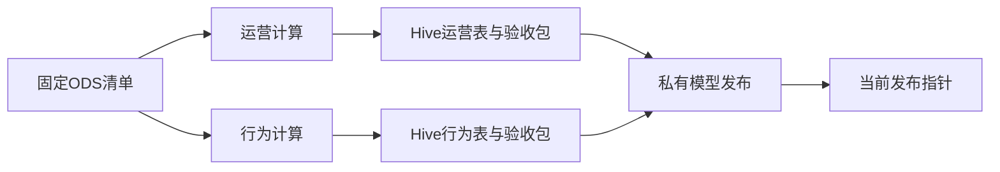

# 26 数据质量门禁与表级血缘

## 正确结果和可解释结果

数据质量回答“结果是否值得使用”；血缘回答“它从哪里来、由哪次任务产生”。有血缘不表示数字正确，有对账也不表示能查清每次发布来源。项目把二者分开实现，再用run ID、输入清单和cutoff建立联系。

一份报表应该能追到已发布版本、验收包、实际作业和原始批次清单。表级血缘表达一张表依赖哪些数据集；列级血缘还要证明每个输出字段依赖哪些输入字段和表达式。当前明确覆盖表级核心任务，不把配置文件里的表名当作列级验证。



## 建立质量门禁的顺序

第一层校验结构：事件版本、字段白名单、类型、允许页面和来源。第二层校验键：event_id、request_id、CDC主键、维度时间区间。第三层校验数值：raw = valid + duplicate + quarantined，以及相同输入cutoff下各引擎日指标相等。第四层校验业务：工单轮次不为负、SCD2区间不重叠、留存分子不超过具备观察资格的分母。第五层校验发布：输出读回一致、版本不倒退、空日期确实覆盖旧值。

验收失败要留证据并阻止新版本生效。质量门禁不应“失败后把结果改成零继续发布”，因为零有具体业务含义。

## 当前血缘如何工作

`SNOW_LINEAGE_ENABLED`默认false。启用后，任务先写本地独立SQLite日志，记录OpenLineage START、COMPLETE、FAIL，之后分阶段投递Marquez。计算线程不等待Marquez联网，治理系统关闭不阻断计算。运行UUID由作业和运行/尝试身份稳定生成；重试必须是新的尝试身份。

当前显式覆盖`snow_models`的运营计算、行为计算与私有发布。实际24条事件、12次运行的后端收据支持该范围。尚未自动补齐Kafka Topic到每个HDFS批次，也没有Flink全部算子或列级关系。发布任务实际读JSON验收包，图中就记录该包，不能为了好看虚构一次Hive查询。

## 可恢复投递操作

先在control确认没有正在写入的冲突操作，用SQLite backup API导出一致快照；不要用普通文件复制代替热备份。新快照路径不覆盖旧批次。

```sh
python3 governance/lineage.py status
python3 governance/lineage.py backup --snapshot runtime/lineage/handbook-delivery.sqlite
```

将文件经已验证SSH复制到分析VM，再在governance profile启动Marquez后操作：

```sh
python3 governance/lineage.py status --database runtime/lineage/handbook-delivery.sqlite
python3 governance/lineage.py flush --database runtime/lineage/handbook-delivery.sqlite
python3 governance/lineage.py export-acks --database runtime/lineage/handbook-delivery.sqlite --receipt runtime/lineage/handbook-acks.json
```

把ack文件传回原control后使用`import-acks`。只接受序号与SHA256匹配的确认。投递端HTTP成功但本地确认前崩溃会重发同一事件，因此投递是至少一次；必须读回Marquez图和运行状态验证收敛。

## 终态丢失不能靠猜

强制kill可能只留下START，即使结果文件已经写好。`status`把它显示为open。`reconcile-failed`仅根据Airflow权威收据里的failed/up_for_retry和结束时间补FAIL；不能凭“超过十分钟”或“文件存在”生成COMPLETE。实际中断探针验证了执行中kill、写结果后终态前kill两种情况，都保留open。用新尝试正常完成后，只有新尝试记录COMPLETE。

## 故障排查与练习

数据库满了时，计算继续但标准错误出现`snow_lineage_capture_failed`，血缘存在缺口。16 MiB日志上限之外，DELETE journal还需要临时回滚空间；不能只看主文件大小。Marquez重建后必须使用新target重新投递，旧后端ack不能证明新库有数据。

题：图中每条边都存在，是否可以写“端到端全链路自动血缘、列级追踪”？答案：不可以。应写“对运营、行为和私有发布三个核心任务实现显式表级血缘，实际读回Marquez验证，Kafka/Flink和列级覆盖仍待扩展”。面试时说明边界比夸大覆盖更可信。

## 对照源码与项目证据

- [docs/lineage.md](../lineage.md)
- [governance/lineage.py](../../governance/lineage.py)
- [governance/dictionary.json](../../governance/dictionary.json)
- [docs/evidence/lineage.json](../evidence/lineage.json)
- [docs/evidence/lineage-interrupt.json](../evidence/lineage-interrupt.json)

[返回学习目录](00-阅读地图与当前状态.md)
