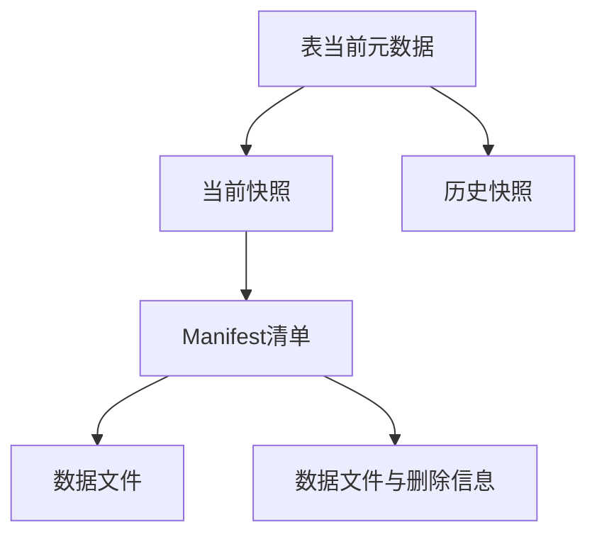

# 27 Iceberg快照、演进与文件维护

> **2026-10-14真实Hive／Iceberg与最终停止已通过：** 原BCE闭日模型包保持原来源，F8／483在`real-small-1792`（control2048／compute1792／analysis1024 MiB）完成真实Hive登记与独立验证。Spark 3.5.7 `local[1]`应用分别为`local-1791973277761`和`local-1791973714447`，daily／session_daily／retention／funnel四组存在性、计数比较及私下行摘要比较均通过。随后真实Iceberg由两个不同YARN应用`application_1791974201828_0001`、`application_1791974201828_0002`完成执行和独立验证，四组当前／适用历史快照及新增`model_revision`列的校验有效，analysis权威确认通过，见[F8真实Hive与Iceberg技术证据](../evidence/real-hive-lake-f8-r2-20261014.json)。公开只给比较布尔与引擎身份，不发布业务计数、行摘要或可枚举的请求／结果／metadata内容哈希。原聚合2026-10-13香港日期对应的90日到期2027-01-11保持；DIM原始输入仍按其独立七日到期。这不表示Lake表已登记到Hive，也不声称分区演进、MERGE、全图或列级血缘、生产P95。

> **本轮独立收尾与公网回归：** Lake完成后，三个节点分别读回原容器身份、HDFS保持、Hive阶段恢复、阶段租约消失；control精确driver／CID／worker不存在。然后`hive-exit`（9316be）与公共`stop-offline`（d58aa2）分别退出0、数据未删除；独立VM状态（4cbe36）在该观察时点运行数为0，项目约61.99GiB、宿主空闲约194.52GiB，正常72GiB／35GiB边界保持。这是当时的观察，不承诺后续永远关机。UTC10:50:48公网只读回归中，两站和统计页HTTP200，测试的私有路由404，v1／v2契约、旧v1隐藏旁路、no-store及26小时快照检查通过；没有POST、付费模型调用或业务数值记录，也没有新增浏览器交互验收。

## 为什么已有Parquet还要表格式

Parquet描述一个文件内部的列式存储。Iceberg在文件之上记录表元数据、快照、文件清单和分区规则，使读者能够一致地看到某个版本的数据。单独把Parquet文件放进HDFS目录，不会自动拥有事务性表更新、时间旅行和分区演进。



本项目选择部分DWD做后期迁移实验，保留原离线主线作为对账参照。目的在于理解版本和维护，不需要将所有低量数据立即迁入湖仓。

## 概念对照

快照是表在某次提交后的可读状态；schema evolution允许按字段身份管理字段新增或变化；partition evolution允许新文件使用新的分区规范，旧文件仍按旧规范解释。隐藏分区意味着查询仍可按业务字段过滤，由表格式选择相关分区，业务方不必拼接底层目录。

MERGE根据业务键更新或插入；DELETE使当前快照不再返回目标行。底层旧文件是否仍存在、能否清理，取决于历史快照和保留策略。删除当前行并不等于历史所有字节已经擦除，所以真实数据保留策略必须覆盖快照和辅助文件。

## 已实际完成的实验

固定Iceberg1.10与Spark3.5.7组合，以9万条DWD建立format v2表和月分区，新增classification_revision字段，MERGE更新一条记录，分区由月演进到日，追加2条、删除1条，最终90001条。重写数据文件后逻辑结果相同，原始快照仍能读取90000条。

文件维护这次将2个文件变成8个文件，因为数据分布在8个日分区。它不是“小文件数量必然减少”的正面性能结论。Iceberg分区变细可能增加文件数，应测量查询选择性和文件开销，而不是只盯一个目标。

实际停止/恢复NameNode之后，新YARN应用读到相同最终快照。该实验不包含HDFS双NameNode自动切换、并发多写者、快照过期清理，不能把这些能力写成已验收。

## 安全复现步骤

在Windows仓库目录，先阅读资源章并确认所有其他VM已停止；每次使用新的attempt：

```powershell
uv run python tools/run_scale_guarded.py --help
uv run python tools/run_scale_guarded.py --events 100000 --workload lake --attempt handbook-lake-001
```

NameNode恢复专题需要先核对上一步成功收据，再在control执行对应`restart_lake_namenode.sh <attempt>`；随后用`--workload lake-verify`在新应用中读回。这里不直接给连续一键故障命令，避免在前一步没有成功时继续停服务。脚本注入的资源门禁停止实验，属于受控故障，不代表实测内存耗尽。

## 验证和排查

至少保存表schema、partition spec、前后snapshot ID、各阶段行数、MERGE目标行、最终数据双向exceptAll、恢复后新application ID。只看“SQL执行成功”无法确认更新是否命中正确业务键。

如果历史快照读不到，先查当前表位置和元数据是否来自同一实验，再查是否执行过expire_snapshots或物理删除。若文件数比以前多，先按spec/partition解释分布；不要立刻执行删除或把分区目录挪到别处。维护文件应通过表格式操作，否则可能出现元数据仍引用不存在文件。

## 练习与答案

题1：当前DELETE之后查不到数据，是否表示所有历史快照都没有该行？答案：不是，旧快照可能仍引用包含该行的旧文件。

题2：月分区改日分区，是否必须把全部历史目录重命名？答案：不需要靠手工改目录完成；表元数据记录分区规范演进，新旧文件可共存。是否重写历史文件应由查询收益、保留和资源预算决定。

## 对照源码与项目证据

- [docs/lake.md](../lake.md)
- [warehouse/spark/iceberg_dwd.py](../../warehouse/spark/iceberg_dwd.py)
- [warehouse/spark/iceberg.sql](../../warehouse/spark/iceberg.sql)
- [tools/run_scale_guarded.py](../../tools/run_scale_guarded.py)
- [docs/evidence/lake.json](../evidence/lake.json)

[返回学习目录](00-阅读地图与当前状态.md)
