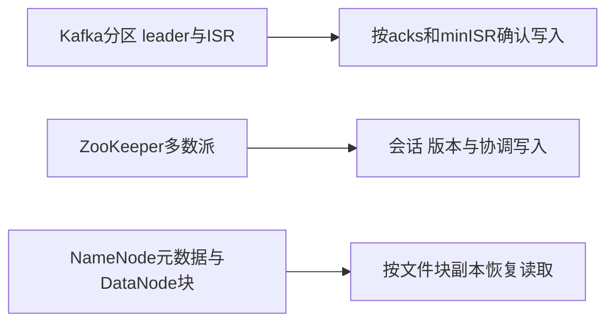

# 29 Kafka、ZooKeeper与HDFS故障专题

## 三种复制不能混为一谈

Kafka分区副本保护消息可用性，ZooKeeper多数派维护协调状态，HDFS副本保存数据块。它们的选主、确认条件和恢复方式不同。三台虚拟机仍然共享一台物理机、电源和磁盘，能验证软件故障行为，不能证明物理机容灾。



日常Kafka使用单节点KRaft。ZooKeeper是独立专题，不能说“KRaft Kafka运行依赖ZooKeeper”。专题为节约资源在同一分析VM内顺序运行三个Kafka进程/容器或三个ZooKeeper节点，不把它们描述成三台独立物理服务器。

## Kafka已验证的故障边界

三个KRaft combined broker，副本因子3，min.insync.replicas=2，producer acks=all。停止当时leader2后，leader转为3，ISR为2，满足确认条件的写入成功。严格主题minISR=3时，同样单故障写入出现NotEnoughReplicasError。再失去两个节点后无法取得正常确认，恢复全部节点后按offset读回已确认消息。

写请求超时或返回错误并不总能推断“消息绝未写入”。客户端可能错过成功响应，重试可能造成重复，因此仍需业务幂等。该次不确定探针读回零条只描述那次观察，不能推广为Kafka对所有错误的保证。

## ZooKeeper已验证的故障边界

三节点ZooKeeper3.9.3。leader由3切换到2，watch收到CHANGED；使用旧version=0做CAS失败，当前version=1保持正确。单独客户端被终止后，临时节点在会话超时后消失。丢失两个服务时，新客户端建立会话超时，无会话不能继续写；恢复后持久节点保留，已失效临时节点不会复活。

watch是状态变化通知机制，应用收到后应重新读取当前状态；不能把一次通知当作每个历史变化的完整流水。CAS用于“只有版本没被他人改变时才更新”，防止丢失更新。

## HDFS副本与HA边界

主线有两个数据块副本，停一台DataNode仍读回相同文件SHA256。这证明该实验中存在可用副本。Iceberg实验还验证单NameNode进程重启恢复。双NameNode HA涉及JournalNode、ZKFC、fencing和客户端故障切换，配置目录存在不代表这套链路已经验收；阅读`lab/hdfs-ha/README.md`标注的状态。

## 操作前后检查

在Windows先看工具帮助并检查当前VM状态：

```powershell
uv run python tools/vmware_lab.py status
uv run --extra lab python tools/smoke_kafka_ha.py --help
uv run --extra lab python tools/smoke_zookeeper.py --help
```

先停其他VM，再把analysis配置为ha profile（3 GiB）并启动。Linux端`start_ha_node.sh kafka-ha`与`start_ha_node.sh zookeeper`顺序运行，不同时开两组。具体lane需要新值，保持命令与env一致。脚本finally会收尾对应容器，但仍需检查VM并按正常流程关闭。

保存故障前leader/ISR或quorum状态、每次停止与恢复时间、客户端结果、恢复后读回证据。故障注入结束后确认所有副本/会话恢复到期望状态；不要只截一张“leader变了”的图。

## 练习与答案

题1：RF3、acks=all是否总能容忍两台机器坏掉后继续写？答案：不是，还受ISR、minISR及控制面多数派约束。本实验minISR2要求至少两个同步副本可确认。

题2：临时节点在客户端断开瞬间就必定删除吗？答案：通常按会话是否失效判断，需要等待会话超时；网络暂时中断与会话结束不是同一事实。

题3：HDFS两个副本放同一硬盘不同容器，是否能保护硬盘损坏？答案：不能，仍共享硬盘故障边界。实验报告必须写明部署位置。

## 对照源码与项目证据

- [docs/ha.md](../ha.md)
- [docs/evidence/ha.json](../evidence/ha.json)
- [lab/hdfs-ha/README.md](../../lab/hdfs-ha/README.md)
- [tools/smoke_kafka_ha.py](../../tools/smoke_kafka_ha.py)
- [tools/smoke_zookeeper.py](../../tools/smoke_zookeeper.py)

[返回学习目录](00-阅读地图与当前状态.md)
