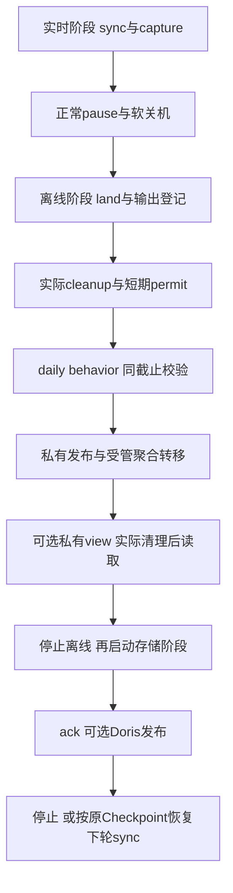

# 30 日常运维、备份、精简与移除

> PowerShell 示例从克隆后的仓库根目录运行。标注为历史的命令和 `runtime/real/operator/` 记录依赖当时的私有环境。新的合成复现按 [README](../../README.md) 与 [分阶段运行手册](../runbook.md) 操作。

> **2026-10-13当前运行状态：** 04真实同步、同前缀归档／Doris／线上SQLite对账、原Checkpoint的VM重启恢复，以及源归档与ODS信封一致、HDFS内容哈希与两个实际副本、Kafka提交后独立位点读回均已通过。04最后已受控paused，未删除存储、未延长期限；13:20香港时间最终读回确认运行VM为0。03早期比较失败保留，不冒充已正常暂停。[本轮证据](../evidence/real-recovery-20261013.json)只覆盖有限接收前缀，不是完整业务日。

> **下次运行先做：** 使用`runtime/real/config/production-real-prod-04.json`的status／describe核对入口；旧`production.json`绑定已退役01，不可直接运行。本章旧日期的storage V3与closed-day V1操作是历史说明，不能换个run ID就套到04。03／04原期限在10月20日，精确时刻以私有登记为准；到期清理必须先于真实读取、恢复、消费者和看板。没有到期时也不为绕开准入而提前删除03。项目预算72GiB、停止线71.75GiB，宿主35GiB空闲磁盘／4GiB可用RAM不变。

> **下一步闭日计算：** 2026-10-13业务日尚未结束，不能造未来cutoff。需先受控准备04闭日输入与作业范围，自然闭日后再观察实际截止、覆盖和缺口，完成计算及独立发布验收。03失败登记原样保留；显式核验并选择它的兼容离线入口已完成三机启动、状态与停止实测，见[统一入口证据](../evidence/offline-followup-20261013.json)。默认入口不会自动忽略失败现场；实际下一轮仍须重读状态并使用本次匹配的选择参数。新手先使用[第36章](36-常用命令索引与执行位置.md)的只读命令，不把历史全流程当作当前一键运行脚本。

## 先区分四个动作

暂停消费者只是暂时不读取；切轻量模式保留线上基础统计；完全关闭停止新增采集并处理已接收数据；彻底清理才涉及删除。本项目把这些动作明确分离，停用本身不自动删除数据库和历史成果。


个人站公开汇总始终来自轻量服务，因此从完整切轻量不必改页面数据来源。业务构建、聊天、签名状态与IndexedDB不依赖本仓库。共享服务器仍有共同宿主故障边界，所以要观察总内存和磁盘，不能只看统计进程自己健康。

## 日常检查顺序

先检查时间与数据新鲜度，再检查服务状态、拒收/缺口、磁盘与备份。公开页过期是症状，不能通过刷新generated_at掩盖。私有增量同步长时间未运行时，先计算七天原始保留窗口是否已经出现缺口；缺失历史不能编造成零。

检查服务日志时只看结构化诊断计数、错误类型、运行身份，不导出原始用户事件或请求内容到学习文件夹。截图展示时使用合成数据，避免把真实小样本标识、服务器路径或配置凭据放进视频。

## SQLite备份为什么不能直接复制

先读本章新增的真实操作路线，再区分后面的SQLite练习。练习库只含合成两行数据；不能把练习的备份命令直接改路径套到正式库。真实运行的原始/辅助/聚合副本必须登记原到期时间，备份不是逃离保留期的副本。

WAL模式的数据可能还在-wal文件中，单独复制主.sqlite不保证包含已确认事务。复制正在变化的一组文件也可能跨时点。应使用SQLite backup API得到一致副本，再校验并关闭连接。正式备份要在私有运行目录保存，权限继承不能向普通静态目录开放。

第01章demo生成的是JSON文件，并非SQLite库。先用下面脚本建立一个明确的合成SQLite练习库：保存为runtime/handbook-create-backup-fixture.py，再运行uv run python runtime/handbook-create-backup-fixture.py。重复练习换一个新目录，不覆盖已有源库。

```python
from contextlib import closing
from pathlib import Path
import sqlite3

source = Path("runtime/handbook-backup/source.sqlite")
source.parent.mkdir(parents=True, exist_ok=True)
if source.exists():
    raise SystemExit("已有源库保留，请使用新的实验目录")
with closing(sqlite3.connect(source)) as db:
    with db:  # 事务提交/回滚；外层closing负责关闭连接
        db.execute("CREATE TABLE synthetic_daily(day TEXT PRIMARY KEY, pv INTEGER)")
        db.executemany("INSERT INTO synthetic_daily VALUES (?, ?)", [
            ("2026-01-01", 3), ("2026-01-02", 2)
        ])
print("Created a two-row synthetic backup fixture")
```

然后用以下backup API脚本备份。不要把示例源路径替换成生产库后随意执行覆盖操作：

```python
from contextlib import closing
from pathlib import Path
import sqlite3

source = Path("runtime/handbook-backup/source.sqlite").resolve()
target = Path("runtime/handbook-backup/backup-001.sqlite")
if not source.is_file():
    raise SystemExit("先建立明确的合成实验源库")
if target.exists():
    raise SystemExit("备份目标必须是新文件")
with closing(sqlite3.connect(source.as_uri() + "?mode=ro", uri=True)) as src:
    with closing(sqlite3.connect(target)) as dst:
        src.backup(dst)
        assert dst.execute("PRAGMA integrity_check").fetchone()[0] == "ok"
```

Python的sqlite3连接自身作为with上下文仅处理事务，不自动关闭文件。这里用contextlib.closing明确关闭连接，避免Windows仍持有数据库文件句柄。

`resolve()`把源路径转成绝对路径，供`as_uri()`生成只读连接使用；运行前还要确认它属于预期实验目录。备份成功后验证表行数和关键汇总，不把integrity_check当成业务正确性保证。

## 当前首闭日路线：先确认传输，再计算发布

当前正式epoch已存在，配置固定`production.json`。这条路线使用storage V3、公开`real-small-1792`和closed-day V1；每一步都须源码、受审工具和实际回执匹配。它说明待执行依赖，不把代码或CI通过写成业务链通过。

```text
storage V3 start-storage（writer仍paused）
→ closed-day V1 observe-cutoff（固定首日）
→ storage V3 start-realtime → resume-writer → sync → capture
→ pause-writer → stop-epoch（实际停止并软关）
→ real-small-1792 start-offline → land → stop-offline
→ storage V3 start-storage → ack
→ closed-day V1 closed-register → storage V3 stop-epoch
→ real-small-1792 start-offline → prepare → cleanup → permit → stage-compute
→ daily → behavior → validate → publish-private → stage-release → stop-offline
→ storage V3 start-storage → closed-day V1 publish-doris → storage V3 stop-epoch
```

storage与closed-day的**每个phase分别inspect，核对新scope后execute**；离线每个phase检查退出码和实际回执，不能整段盲贴。命令格式统一见[第36章](36-常用命令索引与执行位置.md)。本机全过程不影响线上轻量统计。

首日固定为香港2026-09-19，run=`real-prod-20260919-closed01`，cutoff=`2026-09-19T16:00:00+00:00`。香港9月20日00:00自然截止已到；计算资格仍取决于实际输入、连续性、期限与许可，不等于报表已生成。首日观察起点是实际日中开始，不能倒填香港午夜，D1/D7与D+3门槛也不因此成熟。

`observe-cutoff`在原storage在线、writer完整paused且两个Flink停止时读取实际私有status，记录不可覆盖的已提交前缀目标。目标声明`wall_clock_watermark=false`：排队请求可能在观察之后提交，它不是穷尽截止时刻全部HTTP请求的水位。sync需覆盖该目标，后续迟到与7日校正另做。不能为了追新流量不断改首闭日目标。

capture不提交消费者进度；land写HDFS并实际回读双副本；之后回原storage ACK已落地范围。**本次固定首日先ACK，再closed-register登记coverage，然后才能计算**。较早ODS回执不能替后来质量前缀确认。closed-register核原归档连续初始链、同collector/集群/topic、实际ACK、无pending/gap和目标覆盖；它创建固定job/coverage，不接受手写成功证据。缺证据时保守拒绝，不改时间/run来凑通过。

prepare登记范围但不给读取许可；cleanup实际处理到期所属副本；permit绑定同job/ODS/coverage且最长15分钟，不延长数据原期限。stage-compute转受校验元数据，daily/behavior须同source/快照/cutoff；校验失败不发布。stage-release将受管聚合交analysis并读回，保留原90日截止。只有这一步实际通过，才能在新storage窗口publish-doris；后者实际写数据库，不是纯只读。

私有view、Hive和Iceberg另有生命周期与资源准入，不自动包含在首闭日完成声明里。新Lake挂载指纹不迁移旧未结束stage owner、不重写历史hash；先按原身份恢复释放，未知lease阻止新阶段。正常结束仍是先pause活动writer，再stop-epoch实际确认所属引擎全停后软关。

## 机制参考：旧统一路由与一般作业参数

**以下保留原详细步骤用于理解业务阶段／隔离新环境，不能直接用于当前正式实例恢复。** 裸`real_lab`的Windows包装没有本轮storage V3／1792／closed-day的全部控制边界。示例`run.json`及手工job只是参数示范；本次首闭日使用上面的固定工具登记，不手填coverage。旧路线曾将ACK放到模型后；当前首闭日明确采用上面的“先land/ACK、再登记和计算”顺序。

### 旧路由机制分解（不是当前操作卡）

以下是旧统一入口的机制说明。前置条件是第13章已配置并实际初始化真实writer，源码/JAR/epoch仍相同，第13章sync/capture已成功且capture确有输入。当前正在逐步验收的真实生产链，不能仅凭这些编排步骤宣称已通过；没有实际回执的阶段仍按待验收处理。



### 1. 由实时阶段切到离线阶段

先等待当前sync返回，然后正常暂停。每行成功后检查输出，才能运行下一行；任何失败都停止这一条操作路线并保留已有进度。

```powershell
# 机制／隔离新环境参考；当前正式实例按第36章受控入口操作
uv run python tools/real_lab.py --config runtime/real/config/run.json pause-writer
uv run python tools/real_lab.py --config runtime/real/config/run.json stop-epoch --power-off
uv run python tools/real_lab.py --config runtime/real/config/run.json start-offline
uv run python tools/real_lab.py --config runtime/real/config/run.json land
```

离线阶段使用三台scale 2/2/1GiB，只启动精确HDFS/YARN服务。analysis保留本次capture原目录，Kafka/Doris/Flink保持停止。land写HDFS并回读生成ODS快照；这一步仍不向Kafka提交消费位点。缺少pending批次或没有新输入会明确返回no_input，停止新建计算作业；不要补写一个空batch当成功。所有真实输入都有原到期时间，到期批次不能靠land重置寿命。

2026-09-19新增的资源紧张备选是把上述start-offline一行改为`uv run python tools/real_lab.py --config runtime/real/config/run.json start-offline --offline-profile real-small`。它使用2048/2048/768MiB，每台启动额外预留256MiB；其他phase不接受此参数。此处校准时仅有源码/单元检查，实际小合成和真实阶段仍待验收。768MiB analysis不得并发Hive客户端、治理、Doris或Flink；已有Hive登记且检查资源不够时，清理/看板保持关闭，不能跳过Hive检查。

### 2. 准备一个具体的作业请求与观察覆盖

作业请求不是成功回执，它说明本次想算哪个日期范围、使用哪一份ODS输入。文件放在 **analysis** 的`runtime/real/jobs/<run-id>.json`，覆盖文件放在`runtime/real/coverage/<run-id>.json`。新run-id只用字母、数字、下划线、连字符，最长100字符；失败重算用新的run-id，不覆盖不可变结果。成功重跑可以引用同一有效输入，但仍重新计算并校验新输出。

| job字段 | 应从哪里填写/如何检查 |
|---|---|
| run_id、kind、source | 本次新run-id；kind为daily；source固定real |
| input | 本lane最新已提交`runtime/real/ods/<lane>/state.json`中的精确input URI，不手拼一个相似快照路径 |
| warehouse_root | `hdfs://实际controlIP:9000/snow/warehouse/real/本lane` |
| auxiliary_root | `hdfs://实际controlIP:9000/snow/auxiliary/real/本lane` |
| date_from/date_to | 要计算的香港业务日期，闭区间；输入窗口足够且真实发生才有可计算意义 |
| cutoff | 本次明确的UTC截止，带时区；daily和behavior共用 |
| coverage_file/permit_file | 都必须恰好为`<run-id>.json` |
| auxiliary_file/register_hive | 当前统一入口分别固定null和false；已有辅助续算及独立Hive流程另行走已登记入口 |

coverage包含`schema_version=1`、`source=real`、collector的`instance_id/generation`、`continuous_from/through/gaps`。代际来自受控同步记录；through与cutoff相等；观察起点与gaps必须来自本次已确认的读取覆盖和缺口记录，不能用最早事件发生日推断历史完整。事件日没有行、没有出现gap文件、或日PV为零，都不单独证明那个日期完整。无法证明覆盖时保留缺口，留存应为pending/incomplete及null，不填一份空gaps伪装完备。

这些配置留在私有runtime，不复制到学习手册。初版统一入口不自动猜job和coverage；操作者需要明确冻结本次请求并由校验检查。不知道各值从哪里来时先停止，回看第13/16/21章，而不是搜索一份成功JSON套用。已有30日辅助状态的继续计算不能简单改成auxiliary_file=null；那会丢掉观察上下文，应使用已经登记的辅助清理与续算流程，尚未接入的编排明确保持待完成。

### 3. 先登记、实际清理，再给计算许可

下面`$runId`是前一步已经准备好的同名文件，不是工具会自动创建的输入：

```powershell
# 机制／隔离新环境参考；当前正式实例按第36章受控入口操作
$runId = Read-Host '输入已准备job和coverage的本次run-id'
uv run python tools/real_lab.py --config runtime/real/config/run.json prepare --run-id $runId
uv run python tools/real_lab.py --config runtime/real/config/run.json cleanup
uv run python tools/real_lab.py --config runtime/real/config/run.json permit --run-id $runId
uv run python tools/real_lab.py --config runtime/real/config/run.json stage-compute --run-id $runId
```

prepare登记预期输出和实际writer的所有后端副本，**不给读取许可**。cleanup会实际清理已到期且明确归属的副本；permit还要绑定具体job、ODS、coverage、来源和全部输出。当前停机引擎用实际Docker对象/标签/原窗口及writer登记校验，回执明确是“停止副本尚未到期”，不谎称做了在线SQL删除或Kafka扫描。未知资源、对象替换、清理失败都会阻止permit。

stage-compute只把本次经过校验的元数据交给control，不移动真实原始行。计算许可最长15分钟，同时受数据原期限限制。过期后应重新真实cleanup/permit并stage-compute，不编辑JSON延长时间。如果已到原始7日截止，正常计算许可将拒绝，下面的模型步骤不能继续；已有90日聚合按本章后面的独立读取路线处理。

### 4. 计算、同截止校验和私有发布

```powershell
# 机制／隔离新环境参考；当前正式实例按第36章受控入口操作
# Windows仓库根目录；执行实际路由到control
uv run python tools/real_lab.py --config runtime/real/config/run.json daily --run-id $runId
uv run python tools/real_lab.py --config runtime/real/config/run.json behavior --run-id $runId
uv run python tools/real_lab.py --config runtime/real/config/run.json validate --run-id $runId
uv run python tools/real_lab.py --config runtime/real/config/run.json publish-private --run-id $runId
uv run python tools/real_lab.py --config runtime/real/config/run.json stage-release --run-id $runId
```

预期daily和behavior属于同一collector代际、Kafka身份、ODS快照、日期与cutoff；质量校验通过后才发布不可变聚合和latest元数据指针。原始输入、有效、重复与隔离计数要能对上，整数日指标在相同截止口径下对账。本文不规定“应该有几位真实用户”：无样本或窗口未成熟就保持其真实状态。

stage-release要求control和analysis的SSH都可用。它仅转移已验证聚合pair，经Windows中转再登记到analysis，保留原90日截止；不转原始事件或Checkpoint。正式Doris写入只在analysis进行，不打开control到Doris的绕行权限。传输成功不等于SQL发布成功。

### 5. 在离线检查窗口打开私有看板

完成stage-release且HDFS/已登记Hive等检查服务可用时：

```powershell
# 机制／隔离新环境参考；当前正式实例按第36章受控入口操作
uv run python tools/real_lab.py --config runtime/real/config/run.json view --run-id $runId
```

view在analysis监听`127.0.0.1:8502`，第一次展示前实际执行远端生命周期检查、本地聚合副本90日清理、已登记HDFS范围与发布包校验。它不会为看图偷偷启动VM或整套profile。检查窗口不可用时显示“私有看板已暂停”和上次有效截止，不给零结果。许可仅在当前进程短暂保留，最多60秒且被更早到期时间截短；到期再次检查，不能从磁盘导入旧成功回执。

Windows需要访问时，在另一终端建立**本项目VM**隧道，主机公钥仍使用seed信任：

```powershell
# 机制／隔离新环境参考；当前正式实例按第36章受控入口操作
# Windows；目标是analysis VM，不是正式业务服务器
$analysisIp = Read-Host '输入已核对的analysis NAT IPv4'
$labKey = (Resolve-Path -LiteralPath runtime/vmware/id_ed25519).Path
$labKnown = (Resolve-Path -LiteralPath runtime/vmware/known_hosts).Path
ssh -i $labKey -o "UserKnownHostsFile=$labKnown" -o HostKeyAlias=snow-analysis `
  -o StrictHostKeyChecking=yes -o ExitOnForwardFailure=yes `
  -N -L '127.0.0.1:18502:127.0.0.1:8502' "snow@$analysisIp"
```

浏览器打开`http://127.0.0.1:18502`。预期看到本次run与数据截止，私有结果不能当成公开视频素材。关闭时先在view终端Ctrl+C，再关闭隧道；这不会删除聚合或改变个人站公开页。若状态为暂停，先查阶段与清理错误，不能换成直接运行旧`dashboard/app.py`读取真实文件绕过门禁。

### 6. 完成Kafka确认及可选Doris发布，再决定继续或关机

看板已停止、聚合已转移后：

```powershell
# 机制／隔离新环境参考；当前正式实例按第36章受控入口操作
uv run python tools/real_lab.py --config runtime/real/config/run.json stop-offline --power-off
uv run python tools/real_lab.py --config runtime/real/config/run.json start-storage
uv run python tools/real_lab.py --config runtime/real/config/run.json ack
# 可选；只有本次stage-release成功且原epoch仍未到期时执行
uv run python tools/real_lab.py --config runtime/real/config/run.json publish-doris --run-id $runId
```

ack只有在已有完整land回执时推进Kafka位点；缺失或冲突会拒绝。若前面任何步骤失败，保留原pending和状态，下次恢复同一批次，不改位点跳过。publish-doris每次SQL前核验实际epoch/writer和源包，写失败只停止自己的epoch，保留可定位的进度。

当天结束：当前writer此前已paused且没有重新resume，可运行`stop-epoch --power-off`。还要同步下一批：先`start-realtime`，再`resume-writer`，确认实际恢复成功后回到第13章sync。不要在只有存储阶段时运行sync，也不要给已有writer再次initialize。

## 数据到期与关机后的第一次启动

| 副本 | 起算基准/最长可用期 | 处理后能否继续计算 |
|---|---|---|
| 原始批次、Kafka原始/迟到负载、ODS和请求级明细 | 原accepted_at，最多7天；epoch可能更早统一退休 | 超期不能用来补原始明细 |
| 必要去重、首次观察、活跃、会话及归因辅助 | 原来源时间，最多30天 | 只有仍有效且覆盖足够的状态可用 |
| 精确日聚合、私有发布包、受保护公开聚合 | 原业务日期，最多90天 | 可查看已有汇总，不可反推匿名交集 |
| 原始级Checkpoint和引擎卷 | 原epoch截止，不因恢复重置 | 过期拒绝恢复，实际物理退休 |

关机期间没有进程执行物理删除，因此到期清理可能延后到开机。服务再次开放读取前必须执行清理：引擎启动的expire_due处理已登记到期卷，离线cleanup处理ODS/HDFS及已登记后端，本地聚合读取还要处理自己的副本。远端清理成功不代替本地副本到期检查，SQL删行也不等于旧磁盘页已经物理移除。

原epoch过期后不要start-realtime或resume。当前入口可在适当离线检查窗口通过实际退役收据和Docker全量不存在读回，允许仍在90日期限内的受管聚合cleanup与view；它**不签发新的原始计算permit**。保持原lane登记，不把原后端改成not_initialized。若同名容器/卷重新出现、generation不符、未知同epoch资源或退役回读失败，私有读取也关闭。

实际操作是：确认到期监督程序/统一启动的清理成功，再`start-offline`进入所需检查窗口；对已有登记执行`cleanup`，然后对已有成功转移run执行`view --run-id`。不要重新prepare旧raw输出，不运行daily/behavior。若没有已发布聚合，结果就是当前无可读发布物，不用一张零图顶替。该退役后的聚合路径有合成回归；本轮正式环境跨7日物理到期尚未发生，不能写成已经用真实数据等满7天验收。

### 日常故障定位表

| 失败点 | 保留什么 | 恢复原则 |
|---|---|---|
| 私有接口410/源代际变化 | cursor/source/gap元数据及已登记归档 | 明确缺口、新起点；不把丢失当零 |
| capture成功land失败 | 原pending、校验批次和失败日志 | 相同批次重试；不能提前ack |
| permit过期 | 原job/coverage/ODS及失败说明 | 实际重做检查并转移新许可；不改expires_at |
| Spark失败 | 原run输出登记与受管日志 | 定位后新run-id，先验证再发布 |
| cleanup后端不可达 | 清理journal和资源登记 | 进入正确资源阶段，修复实际问题；停止读取 |
| view暂停 | 最后已验证截止和错误类型 | 不用公开零值、未管理文件或旧成功JSON绕过 |
| epoch截止 | 原到期/物理退役证据 | 仅保留有效聚合读取，新采集周期另行登记 |

## 只生成清理范围

在Windows仓库目录运行以下命令只打印清单，不停止、不删除任何资源：

```powershell
uv run python tools/retirement_review.py lite
uv run python tools/retirement_review.py off
uv run python tools/retirement_review.py delete
```

检查清单归属：独立Compose项目、卷、网络、VM目录、定时任务、统计代理路由、凭据和日志。不能执行共享服务器全局docker prune、清空任意父目录或删除业务数据库。真正删除前先导出需要的汇总、合成生成器、模型、锁文件和实验报告；保留项目用于求职复现。

## 完全关闭的操作逻辑

先发布两个产品enabled=false配置，确认不初始化匿名ID、不产生访问事件，再停止独立服务质量转发配置并观察已接收队列。处理完应保留的数据后停止统计服务；网站移除统计页入口或保留带最终时间的静态归档。关闭不是把页面数字强行变成零。

撤回访问同意会清除统计命名空间内匿名和会话标识；已合法接收的历史事件如何按保留策略处理，是服务器数据生命周期，不应承诺撤回浏览器同意就同步删除所有历史存储。这里描述系统行为，不把技术控制说成完整法律判断。

## 验证与练习

历史退出演练已经证明full→lite→off期间轻量数据库和汇总可保持、重复转发不增加指标；反向移除适配器在隔离候选中验证业务基线兼容。曾经失败的Windows热复制/强停实验也保留在证据里，最终采用一致备份和正常停止。新生产版本仍应重新验证自己的精简回退路径。

题：不再找工作后只保留基础统计，需要把Doris迁到线上吗？答案：不需要，轻量SQLite已承担公开基础指标。停止完整数仓并保留公开接口即可。是否删除历史数仓数据是另一步明确操作。

题：原epoch已经7天到期，而昨日的聚合还在90天内，能把epoch时间改新后打开看板吗？答案：不能。实际退休旧原始卷、核验不存在并清理远端及本地副本后，读取仍有效的聚合；原writer、Checkpoint和原始计算许可保持关闭。题：permit文件还在是否可以重跑？答案：不可以，文件存在不证明有效，时间、来源、输入hash、登记和实际清理状态都要检查。

## 对照源码与项目证据

- [docs/retirement.md](../retirement.md)
- [docs/runbook.md](../runbook.md)
- [deploy/resources.json](../../deploy/resources.json)
- [tools/retirement_review.py](../../tools/retirement_review.py)
- [docs/evidence/retirement.json](../evidence/retirement.json)
- [真实统一入口](../real-lab-runner.md)
- [真实远端生命周期实现](../../src/snow_statistics/real_remote_lifecycle.py)
- [退役原始引擎后的聚合准入](../../src/snow_statistics/real_retired.py)
- [私有看板实际读取门禁](../../src/snow_statistics/real_view.py)
- [第24章：先正常暂停再关机](24-Flink水位线Checkpoint与迟到修正.md)

[返回学习目录](00-阅读地图与当前状态.md)
