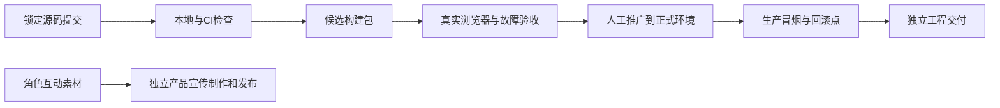

# 31 测试、候选发布与视频前验收

> PowerShell 示例从克隆后的仓库根目录运行。标注为历史的命令和 `runtime/real/operator/` 记录依赖当时的私有环境。新的合成复现按 [README](../../README.md) 与 [分阶段运行手册](../runbook.md) 操作。

> **2026-10-14工程与宣传范围：** 用户确认产品宣传不包含统计功能。录屏、剪辑、成品审阅和发布属于独立的角色互动宣传任务，不作为Snow Statistics上线或工程验收的依赖。下文旧视频安排保留其历史时点；当前操作路线以项目状态和实际版本为准。已上线的统计告知、隐私设置和保护策略保持。


> **2026-10-14真实Hive／Iceberg与最终停止已通过：** 原BCE闭日模型包保持原来源，F8／483在`real-small-1792`（control2048／compute1792／analysis1024 MiB）完成真实Hive登记与独立验证。Spark 3.5.7 `local[1]`应用分别为`local-1791973277761`和`local-1791973714447`，daily／session_daily／retention／funnel四组存在性、计数比较及私下行摘要比较均通过。随后真实Iceberg由两个不同YARN应用`application_1791974201828_0001`、`application_1791974201828_0002`完成执行和独立验证，四组当前／适用历史快照及新增`model_revision`列的校验有效，analysis权威确认通过，见[F8真实Hive与Iceberg技术证据](../evidence/real-hive-lake-f8-r2-20261014.json)。公开只给比较布尔与引擎身份，不发布业务计数、行摘要或可枚举的请求／结果／metadata内容哈希。原聚合2026-10-13香港日期对应的90日到期2027-01-11保持；DIM原始输入仍按其独立七日到期。这不表示Lake表已登记到Hive，也不声称分区演进、MERGE、全图或列级血缘、生产P95。

> **本轮独立收尾与公网回归：** Lake完成后，三个节点分别读回原容器身份、HDFS保持、Hive阶段恢复、阶段租约消失；control精确driver／CID／worker不存在。然后`hive-exit`（9316be）与公共`stop-offline`（d58aa2）分别退出0、数据未删除；独立VM状态（4cbe36）在该观察时点运行数为0，项目约61.99GiB、宿主空闲约194.52GiB，正常72GiB／35GiB边界保持。这是当时的观察，不承诺后续永远关机。UTC10:50:48公网只读回归中，两站和统计页HTTP200，测试的私有路由404，v1／v2契约、旧v1隐藏旁路、no-store及26小时快照检查通过；没有POST、付费模型调用或业务数值记录，也没有新增浏览器交互验收。

> **2026-10-14真实DIM已实际通过：** F8／483来源在显式`real-dim-2560`条件下完成r2，Spark 3.5.7、Python 3.8.10、`local[1]`，实际应用为`local-1791971531318`。`at_event`与`current`两种解析模式的全部字段比较均为true，非空输入验收通过；driver及外层SSH实际退出0，后续独立检查确认本次精确所属容器已不存在，见[F8／r2真实DIM技术证据](../evidence/real-dim-f8-r2-20261014.json)。业务计数和可能被小范围枚举重构的私有结果文件哈希只在私下校验；公开只保留“私有绑定与验证已通过”的布尔结论。这证明本轮真实DIM解析与Join的引擎执行，不会把空历史覆盖补齐：`history_coverage`仍为unknown，unknown也是需正确比较的结果。原输入2026-10-13 04:06:35.627 UTC对应的七日到期2026-10-20 04:06:35.627 UTC保持；没有改写BCE指标、正式产品或公开统计。监控仅有10次宿主采样，54.359秒是SSH窗口时长，不是精确Spark耗时、来宾连续监控或峰值，也不声明VM已关闭。真实Hive／Iceberg和其他结果分别验收。

> **2026-10-14最新源码截点：F8三节点安装已完成。** `f8e3ca8c7823b8736150362ab57316f6a1bca75b`已完成GPG签名、独立验签和推送；push／PR两轮Linux CI共4个作业、54个步骤全部成功，483文件归档与该提交的Git树一致，见[F8签名与CI证据](../evidence/signed-source-f8e3ca8-20261014.json)。analysis、control、compute各自完成prepare、install及独立483文件readback，九个阶段均退出0；每台相对C0F改变16文件，12份冻结writer及依赖保持。配置、恢复元数据和原期限按同一节点的本次fresh prepare与install比较保持，不要求跨节点或与旧历史摘要相等，见[F8三节点安装证据](../evidence/signed-source-install-f8e3ca8-20261014.json)。安装没有启动容器，也不代表引擎验收。原BCE闭日计算、C0F看板／血缘及旧Hive过程继续保留各自实际来源；在源码安装这个时点，DIM引擎尚待实际验收；其后F8／r2已通过，结果见本章最新DIM截点。安装后的全VM关闭是当时观察，后续已进入新的启动窗口，不能作为当前停机声明。

> **2026-10-14有限真实血缘已读回：** 原闭日daily、behavior、publish三任务的六条START/COMPLETE元数据单独投递并获ACK；旧八条fixture元数据排除，后端三任务均为COMPLETED、输入输出身份匹配，有限图非空，见[实际闭日Marquez证据](../evidence/real-closedday-marquez-20261014.json)。六条ACK只属于该子集，06:28:14 UTC（香港14:28:14）的旧后端证据仍保留ACK尚未导回的历史false；随后06:45:27 UTC（香港14:45:27），C0F来源已将六条闭日ACK导回control原journal，原14条元数据身份保持，八条fixture仍未ACK，见[原journal ACK导回证据](../evidence/real-closedday-marquez-control-ack-20261014.json)。四节点三边是本次观察，不宣称整图完整、全部历史边或列级血缘；没有读取业务行。原BCE模型与c0f投递工具来源分别记录。

> **2026-10-14 C0F历史验收截点：** c0f源码已经签名、推送并通过两轮Linux CI；analysis、control、compute已分别完成477文件安装和独立读回，每台27文件变化、12冻结writer及原保护元数据/期限保持，见[c0f三节点安装证据](../evidence/signed-source-install-c0f542c-20261014.json)。旧1b提交只更新文档，不改记成当时三节点安装来源。BCE的daily/behavior/validate/私有成对发布与journal COMPLETE已经有[BCE闭日技术证据](../evidence/real-closedday-20261013-bce1289.json)；Doris新发布只接受[Doris技术证据](../evidence/real-closedday-doris-20261014.json)说明的内部SQL整数读回和技术元数据读取，不冒充新的独立SQL或行为表。私有UI缺依赖的失败保留，锁定依赖已补齐；后续私有浏览器四页签DOM及有限所属进程收尾已有[实际私有看板证据](../evidence/real-private-view-20261014.json)；真实DIM2304在Spark前失败，新的2560仍待实际VM/引擎回执，见[2304实际前置失败](../evidence/real-dim-preflight-2304-20261014.json)。源安装不是生产推广，也不是录制或发布视频完成。

## 当前录制边界（2026-10-13）：分别说明产品和数仓实测范围

个人站统计卡已以签名 `e4d9242` 正式发布，Pages及公网桌面／390px手机、中英文、键盘重试和完整统计页验收通过，77项测试与35页构建通过，见[当前个人站发布证据](../evidence/production-public-cards-20261013.json)。录制时展示每张卡片实际标注的日期和状态；没有已公开日期的指标仍可能等待或样本不足，不能用私有数值替换。小吉的“设置 → 隐私”入口及真实对白录制继续按已验收产品版本办理。

本机04真实前缀恢复、对账、HDFS双副本和Kafka确认已经完成；显式兼容离线入口也完成三机启动、状态与停止实测，[恢复证据](../evidence/real-recovery-20261013.json)和[入口证据](../evidence/offline-followup-20261013.json)分别说明范围。新数仓来源 `50706a8` 已签名并通过两轮Linux CI；三节点均已实际安装并各自回读430文件，见[安装证据](../evidence/signed-source-install-20261013.json)。这些进展不等于真实闭日、Hive／Iceberg、成熟留存或生产P95验收，也不证明历史蓝屏根因已修复。真实业务日期最早在香港10月14日00:00后满足闭日时间条件。

## 历史：9月19日至20日的宿主故障与当时录制边界

本机1792启动在2026-09-19 12:58:19.500 UTC宿主蓝屏时中断，回执没有成功终态；随后一次离线启动在香港9月20日00:50后再次中断，Windows记录BugCheck `0xA`，新启动回执同样没有终态。重启后只读确认三VM和项目进程均为零，不能把它写成正常软停机或来宾恢复。第二个转储的获批 WinDbg 分析已完成，故障位于 Windows 内核异构软停路径，当前进程为 `python.exe`，短栈未锁定责任驱动；当时任务暂停。在该历史时间点，不能录制或旁白宣称本轮一键数仓启动成功。之后的恢复和实测结果见本章开头，不覆盖原失败记录。

已完成的产品版本和历史浏览器验收保留。崩溃后 **13:21:31.552702 UTC（香港21:21:31）** 的独立只读复核已通过：collector lite、reader/forwarder正常，无新增failure/gap/capacity指标，公开v1/v2、no-store、pending/null与私有404边界通过；未POST、修改生产、调用模型或导出事件行/计数。这是有限时点的线上证据，不证明本机guest恢复或全部请求覆盖。 [12:49线上只读观察](../evidence/production-observation-20260919.json)是故障前历史观察，不能挪用它的时刻；视频中的线上产品体验与本机数仓完成范围分别描述。

## 历史：2026-09-19正式身份与当时可开始录制的范围

正式产品身份核对截至2026-09-19 **18:16香港（10:16 UTC）**，小吉当前接收流量的是blue `65fa0d0cfb1e8ad8aafd090f88fab4364629757d`。用户批准精确回执 `5d4038c6b0f04ea147906b9b2f7dbdd15a5cf91ef9e9ea7722f6776e23cad485` 后，18:11香港完成正式应用晋级。旧green `0388b78b079011e28b772462b6c3634668856b59` 停止保留作为应用回滚锚点；共享embedding `465a1dbf…`未变。本次没有再次执行共享模型维护，也没有把旧整份环境覆盖新配置。

个人站在该历史时点为 `cf3d2fb0f7ddb3f5f897a4de5181083363d50c31` / Pages `765c7e23-8350-4f28-bc4b-aac52b0f7c05`，不代表本章开头记录的10月13日最新发布。两个统计开关当时已开启，collector为lite。新版小吉入口为 **设置 → 隐私 → 访问统计设置**，首次提醒仍可直接拒绝；公开角色目录22个，个人站允许路径32条。18:15香港更新的published DIM快照对照实际公开模块、签名源码及原collector允许列表一致，只证明目录元数据，不能当作数仓引擎回执。

### 本次候选、备份与正式回归各证明什么

| 实际执行 | 时间（UTC） | 能据此得出的结论 | 不能推定的结论 |
|---|---|---|---|
| 新备份完成并核查 | 09:44:47完成，09:45:48核查 | 使用既有备份unit；当时current为0388；`pg_restore --list`与`restic check`成功，备份结构可读 | 已把生产数据完整恢复到新系统、任意时间点恢复均成功 |
| 新候选Chrome与健康/资源核对、prepare | 10:07:57生成精确回执 | 新设置路径、允许/拒绝/撤销、键盘焦点、关闭重开、移动/桌面已在候选验收；回执绑定这份候选与当前基线 | prepare等于人工批准；旧回执可授权另一提交 |
| 用户批准后的应用晋级 | 10:10:51批准，约10:11晋级 | blue65fa成为正式；green0388停止保留；embedding未改 | 独立统计库、共享依赖或历史数据被自动回退 |
| 新版正式Chrome | 10:12:34 | 实际HTTPS与实际edge CSP，无CSP注入；首次提醒/拒绝/允许/跨标签撤销；320/390/1440px画面通过 | 模型回复体验已实测；统计故障模拟等于真实事件投递 |
| 两站与collector纯GET回归 | 10:13:00 | 67项检查全过：版本、配置、目录、缓存/CORS、v1/v2保护与私有路径隔离 | HTTP检查等于浏览器交互；公开页可展示内部精确数据 |
| 日志跟随切流后复核 | 10:14:23 | 两unit active、无重启、poll继续；8次socket探针最大0.094秒；历史37次失败没有增加 | 当时不能称质量端到端已有真实生成样例；该时刻质量ACK仍0 |
| 最终正式身份只读复核 | 10:16:08 | current为blue65fa，旧green停止保留 | 此后永远不会发生运行变化 |
| 用户真实对话后的质量端到端 | 10:56:54 | 新完成日志确认、白名单事件入库、请求去重和日整数聚合独立核对均通过；核验只读、不调用模型或读取正文 | 单凭这份较早轻量回执证明本机已同步、所有请求零丢失或P95达标 |
| 新质量前缀实时数仓对账 | 11:51:19–11:52:59 | 新质量已进入Kafka/Flink/Doris；生产SQLite单个只读事务确认同源身份、同接收/聚合前缀及精确日整数一致 | 新增量已HDFS落地、当天闭日报表已完成、历史积压回放证明P95 |
| 最新真实writer安全停点 | 11:54:53暂停，11:56:09全关 | 保存新Checkpoint、原存储未变、五个所属引擎停止、三VM全部关闭；数据与原期限保留 | 当前writer仍RUNNING、停机等于删除数据 |

新版正式Chrome验收中，统计请求4次均在测试浏览器本地拦截为合成503；只放行一次已核对无模型副作用的场景解析，未调用生成模型，其余业务POST受限。因而它是真实公开应用与真实CSP上的交互/故障隔离验收，但不是向正式统计库灌数，也不是用户实际对白的效果评测。首次14:09–14:15真实浏览器采集证据保留为另一个历史观察窗口。

### 实際可操作的发布复核顺序

1. 先确定要发布的源码提交和已签名镜像，而不是只看分支名。候选与当前生产基线都要绑定到回执。
2. 在隔离候选中按正常首次体验和公告流程操作；检查统计设置、焦点、拒绝、跨标签撤销及窄屏。统计故障用合成端点模拟，不用付费模型造测试量。
3. 核对当前备份的完成时间、对应基线及检查范围。备份检查通过不省略候选验收，也不冒充完整恢复演练。
4. 备齐具体回执后办理人工批准与应用晋级。回执过期或候选/配置改变时重新验收，不能改JSON为true。
5. 切流后用正式HTTPS确认实际版本和CSP，再检查公开接口边界。若失败，关闭对应统计开关或按该次应用回滚锚点处理，不执行全局清理。
6. 技术回归通过即可录制，运行观察可与制作并行。固定为65fa0d0版本；用户的真实模型对白另需逐段核对。视频成品审阅、具体账号与最终发布仍由原宣传任务完成。

下面的历史记录用于理解为什么这些门槛存在。**旧时间的off、旧颜色、旧回执或旧路径数不是当前操作指令。**

## 测试通过与生产生效是两件事

源码存在、单测通过、候选构建成功、候选真实浏览器验收、人工推广、生产冒烟分别是不同阶段。Project_Snow要求隔离候选和人工生产推广；不能因为GitHub分支推送成功就说正式系统已使用新代码。

历史准备阶段曾使用个人站6b17f426/预览03b67947与小吉0388候选。它们的具体结果保留在后面的带日期记录；当前正式身份以上方65fa0d0/cf3d2fb为准。两个仓库源码访问统计仍`enabled:false`，个人站由构建环境开关生成dist，小吉由运行时开关返回配置。发布配置开启只允许用户作出选择，不代替主动同意。


## 应用发布与共享模型维护的区别

embedding为两个API颜色共用。即使只升级系统包而保持512维模型，改变镜像digest也属于共享维护，普通stage会拒绝。不能为了消除报错先改当前pin。正确顺序是：保留旧镜像与恢复锚点；新旧镜像在不连业务网络的隔离容器中对同组合成短句推理，并验证模型文件、维度、有限数值、归一化和数值误差；取得完整发布证明；建立独立备份并安排维护窗口；只替换embedding且验证当前API健康；再将真实共享状态写入维护回执和当前配置。应用候选仍需独立验收与人工推广。

这也说明“代码兼容”不等于“完全没有运维影响”。更换共享模型容器可能短暂中断检索；不应将待执行维护写成不停机保证。若应用已经晋级，回退应用前还要审查共享镜像版本，不可以把旧整份compose.env直接覆盖新应用当前配置。

历史共享维护候选曾验证：新旧9个模型文件hash一致，4条合成短句的512维向量最大绝对差0；仅新建fixture容器实际停止、确认健康不可用，再启动并核对相同向量，恢复差0。全部原有容器和活动API健康前后未变。这份隔离候选证据当时只证明该版本、该环境、小样本的兼容与fixture恢复；后来9月13日实际共享维护另有回执。当前新应用晋级未改变共享embedding，也不证明任意输入等价。



## 自动检查覆盖与历史测试数量

共享适配器检查包括同意有效期、跨标签撤销、隐私信号、队列上限、取消与公开状态渲染。两个产品在自己的仓库执行测试和构建，不能依赖本数仓checkout。早期共享23项、个人站64项及当时预览30路径的结果属于对应历史候选；最后个人站正式目录已更新为32路径，新小吉设置有独立Chrome回归，不能把旧数量固定成永久标准。

数仓已签名源63a0d415的Linux CI成功，对应实际正式writer验收。之后签名提交853a8c5及Linux CI35436677208通过，证明新增低资源profile等源码检查。再后来的实际VM回执已证明2048/1920/768 MiB组合跑通56条合成golden及Parquet/整数核对；这份小样本引擎证据仍不等于Hive＋Spark、新Iceberg入口或完整离线治理通过。CI、本地synthetic fixture、实际生产技术检查和真实模型体验必须分别描述。


## 历史18:32香港补记：视频可以引用的新增数仓事实

`real-small-1920`现有实际小样本成绩：56条合成输入、28条有效和28条重复，真实YARN/Spark结果的Parquet读回与基础整数对账一致。节点配置为control2048、compute1920、analysis768 MiB；观测项目峰值63.62 GiB，来宾最低可用内存分别641/669/202 MiB，无OOM。画面和旁白必须注明合成输入、小样本和该资源条件，不能把它说成这个低配已通过百万条或线上持续吞吐测量。

正式传输另有独立证据：真实受管批次已经HDFS双副本落地读回，然后回到原Kafka存储完成消费确认；最终writer暂停、全部实验VM关闭且没有删除数据。适合在面试中解释“先验证落地再提交消费进度”，不适合展示正式事件数量、offset、hash、用户标识或小样本趋势。

该18:32窗口尚无质量确认样例，18:56:54香港后来补齐轻量真实完成事件验收；再后的实时新前缀对账见下节。香港9月19日仍未自然结束，没有真实闭日报表；Hive＋Spark窗口、新Iceberg入口及正式P95不能由旧ODS证据推定。录制可讲已证实的独立环节，不能将旧小样本或CLI帮助画面演示成完整一键流程已通过。

本轮核对依据为本机`runtime/real/operator/formal-closed-loop-20260919.json`与`real-small-1920-golden-resource-metadata.json`，只提取状态和资源信息；只读筛选示例见[第24章](24-Flink水位线Checkpoint与迟到修正.md)。这些私有运行回执不要整份放入视频或公共仓库。

## 19:56香港补记：录制时怎样准确表述质量数仓链路

可以说：“用户正常完成对话后，质量日志先进入轻量统计；随后按需恢复本机原epoch，实际把新的质量前缀送入Kafka/Flink/Doris，并在同一接收与聚合前缀下与生产SQLite及独立基准完成整数对账。随后保存Checkpoint、停止本项目引擎并关闭三台VM，线上统计继续独立工作。”证据为[脱敏数仓对账回执](../evidence/production-quality-warehouse-20260919.json)。

紧接着应说明边界：新质量增量尚未capture/land到HDFS；较早HDFS双副本→原Kafka确认另有旧前缀回执。当天仍无自然闭日报表，不演示真实小计数、请求/用户标识、offset或数据hash，不声称所有业务请求全覆盖或P95已达标。核验不读取聊天正文，不调用模型造流量。

资源与工具版本也要分开：2048/1920/768 MiB已有56条合成golden成绩，2048/1792/768 MiB尚待probes/golden和完整拓扑。匿名父卷与管道退出修复在b1ed28df通过CI后，被de406cb包含并于20:22–20:27香港实际逐台安装；三节点stdin保持打开的worker正常退出均通过，冻结writer不变，见[三节点退出与启动清理证据](../evidence/small-worker-exit-20260919.json)。产品录制可继续，但逐节点退出结果不能演示成三节点同时运行、完整wrapper或Hive/Iceberg联调已通过。

## 20:32香港最新补记：安装验收与诊断处理各证明什么

12:22–12:27 UTC三节点安装和正常退出是新实际证据，不再使用“修复尚未安装”的当前表述。analysis同步清理钩子已在实际监督服务中加载，既存未到期数据、登记和期限保持。12:30–12:31 UTC又独立完成该节点一份已精确关联诊断文件的原子纳管，继承原7日截止、未读core正文；这不属于accepted业务事件、DB或Checkpoint迁移，也不证明期限已经自然到达。

安装采用1792 profile逐台进行；完整并发启动、资源探针、合成golden、后续Hive/Iceberg和真实闭日模型仍待验收。control/compute的同期诊断文件各自关联与处置仍待进行，没有复制analysis scope，也没有把只读检查授权记作inspect或删除已完成。安装收尾在12:32:52 UTC曾确认三VM全关，后续窗口用新回执记录。

## 自己在浏览器按顺序检查

使用干净浏览器上下文或清理**仅统计命名空间**，不要为测试误删用户聊天库。先打开两站，观察关闭配置下没有访问事件和匿名ID。候选启用配置只用于已准备的测试环境；启用后首次出现非阻断告知，接受和拒绝同等可达，键盘可操作，320px宽度按钮可见，桌面无布局覆盖关键操作。

拒绝后浏览器不发送访问统计；独立披露的脱敏生成完成日志按单独开关运行。接受后确认每次事件只有白名单字段；撤销后队列清空、在途请求取消、anonymous/session删除，另一个标签页立即停止。把同意时间设置成测试中过期值，再发起页面行为，应重新检查有效期而非继续采集。

跨站验证必须分别检查两站选择：入口标记只用于一次跳转归因，不合并匿名ID。小吉尚未同意时到达，标记立即去掉；之后才同意不能补录此前旅程。普通业务锚点、查询参数和history.state保持可用。

## 公开页故障状态

分别验证pending、empty、suppressed、published以及整体stale/unavailable。过期页面不能展示伪造零值；聚合缺口响应应保持unavailable，而不是被“时间较旧”降级成可用历史统计。v1兼容归档也不能泄露内部精确计数。浏览器只请求公开汇总端点，绝不拿数据库凭据或读取私有事件。

## 视频制作前的完成清单

| 必须完成的事实 | 证据形式 |
|---|---|
| 两站通知与隐私页已正式发布 | 精确提交、部署版本、正式页面截图 |
| 独立统计域名和接口正确 | 合成探针及响应白名单，不含秘密 |
| 业务在统计异常时正常 | 候选故障日志与正式轻量冒烟 |
| 公开页小样本与过期显示正确 | 合成状态截图和字段检查 |
| 可关闭、可回退 | 关闭配置验证和明确回滚版本 |
| 演示材料不混淆真实与合成 | 画面标注、旁白脚本、证据来源 |

视频不要以真实低量访客行为作为展示素材。可以展示真实网站界面和合成数仓数据，但画面应标明数据来源和日期。预录的历史实验性能应说“在该固定环境测得”，不能旁白成“当前线上每秒处理能力”。

## 常见故障与练习

CSP错误先查是否只允许`https://stats.xiaob.dev`，不要添加`*`绕过限制。配置更新未生效查缓存与实际文件hash；模块导入失败查复制文件是否完整和MIME类型。测试浏览器版本与Playwright不匹配可能导致截图挂起，应匹配安装版本，不删除断言让测试变绿。

题：视频可以先发布，再补生产验收吗？答案：若视频描述“已经正式可用”，必须先取得相关事实；否则只能明确作为开发预览，不宣称尚未完成的上线结果。用户当前顺序是先上线和测试，再制作发布视频。

## 对照源码与项目证据

- [adapters/browser/analytics.test.mjs](../../adapters/browser/analytics.test.mjs)
- [adapters/browser/bootstrap.test.mjs](../../adapters/browser/bootstrap.test.mjs)
- [adapters/browser/public-summary.test.mjs](../../adapters/browser/public-summary.test.mjs)
- [docs/integrations.md](../integrations.md)
- [docs/completion-checklist.md](../completion-checklist.md)

[返回学习目录](00-阅读地图与当前状态.md)

## 9月13日历史安全停点及当时待办（由下节续作更新）

2026-09-13 21:55:35至21:55:50（香港），受控维护仅替换共享embedding；新镜像健康及原API完整健康恢复后才更新实际pin。维护回执明确其余容器未改变。随后green候选stage成功，内网live/ready/full、配置与私有API边界通过；再次读回22个表情manifest的哈希及3张头像缩略图通过，旧embedding镜像和原blue恢复锚点仍保留。此处的替换用时不是严格测得的用户请求中断时间。

首次浏览器验收使用真实staged前端和本地SSH隧道；统计域名请求一律被测试拦截为合成503，不向正式统计库写测试事件，也没有触发模型请求。现有“关于这次体验”说明先于统计操作出现，其中已展示访问选择和独立服务质量告知。脚本随后受自动公告对话框顺序及按钮定位影响而超时，所以本轮完整接受、拒绝、跨标签撤销流程尚未取得通过回执。已有本地单测不替代这一真实候选验收。停止时测试进程已结束、SSH隧道已关闭，绿色候选容器和全部已有收据保留。

下次首先确认当前blue/green/共享镜像与收据是否仍一致，重新建立本次候选私有隧道，读出实际可见公告控件并按正常用户路径确认，不使用force点击或直接编辑业务存储跳过流程。完成首次访问、拒绝、接受、跨标签撤销、移动端与桌面验收后，才能把所有实际通过的检查写入候选evidence，调用candidate_acceptance.py prepare生成有时效的确切回执。准备动作不是approve，尚未完成的检查不得填true。之后由有权人工确认并按产品契约晋级，继续公网与采集端到端验收。

正式统计域名/Tunnel、个人站正式发布、采集开启、本机真实全链路、视频制作发布仍是后续工作；当前不能在视频中声称这些已完成。共享维护已经完成，不应在下次盲目重复apply；应用回退前仍须审查共享依赖版本，不能直接用旧整份环境覆盖现状。

## 历史：9月19日13:26候选0388准备回执

先重新核对远端main、active/green、pending reservation、实际容器ID、共享embedding、collector模式和事件数；没有沿用六天前的状态。结果仍是原blue接收流量、green0388候选健康、collector off/0事件。随后重新核对22个表情manifest的实际HTTP内容hash、3张头像缩略图、build-info与统计模块hash；源码工作树保持干净。

旧浏览器脚本的公告定位失败有具体原因：可见文字“知道了”的按钮已由原产品代码添加aria-label“关闭对话框”，get_by_role按无障碍名称检索，不能再用可见文字当作精确名称。采用真实可见“关闭公告”按钮完成正常用户操作，无须force点击、关闭业务门禁或编辑用户业务存储。

测试在全新隔离浏览器里使用https://snow.xiaob.dev作为页面来源，同时把该来源的全部应用请求路由到私有green SSH隧道，并在本地应用签名候选Caddyfile中的CSP。这样保留浏览器Secure Cookie和Origin检查语义，避免把localhost造成的正常origin_rejected误判成产品故障。这不是公网Caddy已切流或TLS已验收的证据。只读GET遇连接重置最多重试两次，最终完成轮的transport errors为0。

正常首次选择场景会请求POST /public/v1/presence/resolve。源码核对显示该路径只校验公开角色、规范化浏览器状态并签名返回，不调用模型；本轮只放行这个确切、字段受限的场景解析，实际1次200。其他业务POST一律在浏览器拦截；所有统计请求也本地返回合成503，不写正式real库。最终结果：未同意前没有统计命名空间；拒绝后第二页不发送；允许后初始化；跨标签撤销删除统计匿名/会话标识；再刷新仍无新增发送。合计4个统计POST被本地拦截，付费生成请求0。

人工可审回执ID：`5a4305aec3ccf2d98ce154e4cf5d883d034e04c9ed46278f73ed40983520b290`。候选0388、当前f3f绑定不变，prepare时间2026-09-19 13:26:12香港，到期2026-09-20 13:26:12香港。它只表示技术证据准备完成，未人工批准或晋级。候选容器/manifest/config变化或过期都需要重新验收prepare；不能编辑回执延长时间。独立collector配置更新不改变业务候选配置，但必须单独保存其off状态、来源代际和目录对照证据。

本轮没有再做共享embedding维护，也没有重新创建备份；9月13日的维护备份仍是历史恢复材料，不能称为9月19日新鲜备份。后续批准和晋级由产品契约及当时实际门禁决定。最后已关闭本次私有测试隧道和浏览器进程，green保留待人工审阅。

## 历史：9月19日13:37独立公网关闭状态验收

2026-09-19 13:37香港，协调者在用户明确授权后完成独立stats Tunnel与域名接入，并实际验证https://stats.xiaob.dev：公开v1/v2为200、archived、no-store；private events/status、health/docs/openapi及根路径均404；两个业务Origin预检200、陌生Origin400。collector仍off，日志服务仍inactive。公网关闭状态的路由边界已通过，不代表正式采集已经开启，也不替代业务产品的人工候选晋级。

同日13:39香港核对现有应用备份：最近成功为当日00:03:26，当前f3f基线匹配，年龄约13.6小时；匹配snapshot与日常tag存在，restic check实际通过，仍在既有26小时监控阈值内。普通应用晋级没有历史共享维护工具的1小时pinned门槛，当前无须为那个已完成的维护再建备份。若后续等待导致过旧或状态改变，再按实际风险和既有backup协议刷新；本轮没有执行完整恢复演练，不能把结构检查写成恢复成功。


## 历史：9月19日13:42首次晋级与个人站主线整合

本节是前述候选准备之后的实际更新。用户明确批准精确回执5a4305ae后，由协调者按产品流程完成批准与晋级，时间约2026-09-19 13:42香港。公网build-info实际返回0388b78；live返回200，ready/full继续在公网隐藏为404，运行时统计配置为true且no-store；原blue停止并保留。这里的访问配置true只表示用户可以选择同意，collector仍off，不能据此宣称事件已接收。正式域名读回没有调用付费模型。

个人站合并时发现主线出现另一项合法内容提交c08ff5e。精确基线保护阻止使用旧main直接合并。核对后发现仅包含开发日志011、日常页日本旅行准备及对应测试，GitHub没有关联PR，不能将它误判成统计PR已合并。隔离候选保留这些改动并合入主线，重新构建实际页面：总34页，允许收集的公开路径32条。新增允许路径仅/journal/development-log-011/和/now/daily/japan-trip-preparation/。角色仍22个，来源仍两个固定HTTPS域名。

最终候选66dbafe的64项测试、Astro88文件零错误零警告、构建和32路径HTML存在性检查通过；Cloudflare候选a95abaca检查成功后，使用expected head合并PR2，main成为cf3d2fb。候选与该合并提交的文件树完全相同。生产Pages构建4a332c46已经触发，两个统计构建开关保持false；最终正式页面与后续开启仍由协调者验收。没有覆盖并行内容，也没有force push或绕过检查。

这说明允许列表不是一次生成就永久准确。每次新增公开页面，都先从该产品真实构建的sitemap及明确公开页面生成路径，再在采集关闭时对照独立collector的白名单；更新自己的公开配置，不修改业务服务或把统计仓库变成产品构建依赖。目录中的candidate/published标签必须与对应正式部署证据相符，Git合并本身不能冒充浏览器已经看到该版本。


## 历史：9月19日14:08首次轻量采集启用

完成两站发布、告知与公网检查后，协调者审阅具体独立计划并授权执行。2026-09-19 14:07:42至14:08:25香港，执行器仅把SNOW_MODE从off改为lite、把SNOW_LOG_FORWARD_ENABLED从false改为true，并启用已安装的reader/forwarder。它没有修改产品容器、Caddy业务路由、业务数据库、共享embedding、collector镜像或凭据；256MiB/0.25CPU、配额挂载、回环端口等保持不变。

启动先确认collector健康及公开汇总ok/empty，再启动reader，等待本次新poll和UNIX socket就绪后才启动forwarder。这个等待避免首次连接reader尚未就绪时产生失败计数。两者实际均enabled/active、重启0、失败0、不完整poll0。公开v1/v2为200/ok；网关private/status/health/docs仍404。首次启用回执确认当时尚无已接收事件；没有主动注入任何事件，也没有调用付费模型。日志ACK增量为0，所以只确认了空载进程与进度可用，没有伪称本次已有真实请求成功投递。

计划对root私有.env与server-token做0600检查；server和reader凭据不同，forwarder的LoadCredential文件与collector服务端凭据在内存中比较相同，不输出值或把它们复制到本手册。转发器用户不属于docker、sudo或root组。原有日志读取回看600秒，spool和游标属于本项目；新启用不代表全历史完整，覆盖缺口计数需要持续查看。

执行失败会分别尝试停止及禁用自己的两个日志unit，再恢复自己的off配置和collector。任一stop失败仍继续其他步骤；并行业务重启不会阻止关闭统计。若配置已被另一个明确变更更新，拒绝覆写新配置并保留recovery-incomplete收据。所有恢复只停止新增采集，不删除已确认的事件、spool或游标。使用该次plan的rollback/recover是有边界的恢复操作，不应把已过期的历史apply命令作为今后通用启用命令复制执行。

学习时区分三层证据：14个合成恢复/漂移/启动顺序测试证明工具分支行为；生产apply回执证明这次变更及空载状态；启用后的浏览器和真实完成事件回执才证明实际业务采集。三者不能互相替代。


## 历史：9月19日14:09–14:15真实采集与撤销

在旧正式0388窗口，测试者分别同意两站的访问统计。少量真实浏览器访问、角色选择和入口行为被接收并聚合，观察到的跳转片段在目的页面清除且归因匹配。因受控浏览器未暴露自动打开的新标签，当时是在另一标签打开观察到的目的链接；该证据不涵盖完整自动弹窗路径。

两站分别撤销后，其他标签页设置同步关闭，继续页面导航、小吉角色选择与输入仍可用，后续只读回验没有因此增加采集。这里不公布内部小计数、位点或标识，也不把验收操作当作自然用户数量。质量链路没有已确认生成样例，未发付费请求。18:12新版公开Chrome则将统计传输本地拦截为503，这两类证据范围不同。

## 9月19日16:36真实运维修复及其验收范围

启用并不意味着从此不再复查。16:27香港只读观察发现：两日志进程active、0重启，collector也健康，但forwarder历史failures=33。8次socket探测中一次在3.002秒超时，紧接的一次约1.005秒，其余约0.001秒；spool为0，质量ACK0。源码审阅定位到主循环串行执行长轮询与socket.accept这一结构性问题。

修复提交为`34d7b989a5b94fab2d31ff9b6104072ead0040f7`，10项相关合成测试和Ruff通过，远端CI运行35432204548成功。改动仅为reader拆出单个有界后台poll，主线程保持SQLite及socket所有权；forwarder、权限、白名单、保留规则、资源限额和产品业务代码不变。

发布工具也单独接受恢复审阅与6项本地mock检查。它冻结旧/新文件及配置，停止日志进程后确认inactive和MainPID=0，再替换一个reader文件并重启；恢复原版时要求新的进程启动标识，不能因磁盘文件已恢复就误称运行进程已换回。中断后的recover可在计划过期时只校验独立日志资源后恢复，不要求业务容器仍是旧状态。原版本来就可能长时间串行poll，因此恢复等待允许有界的更长时间，并明确原缺陷仍然存在。

协调者于2026-09-19 08:36:12.292076 UTC，即香港16:36:12完成正式升级。精确计划hash为f77136aca5f9ed1d4e7103137e0abd712b2fd777b495d66333efdcd877780367；正式reader文件hash为3a50ad75936e17bcfea458789a5fa29d3953592610defdf613db645c9d6ac32a。这里只记录身份用于对照，不将已经执行的历史计划作为今后可以重复apply的操作步骤。

生产回执报告：45秒内113次AF_UNIX白名单探测，最大0.045秒；升级前forwarder累计失败已从首次观察的33变为37，升级后仍37，没有新增失败或清零。reader失败、不完整poll均0；两者的进度时间都前进；业务与配置未变，历史状态保留，注入事件0、原始记录导出0。

演示或面试可以据此说：“观察到进程存活但局部读取超时，结合socket耗时和代码找到慢轮询阻塞主循环；以单任务后台采集保持主线程及时提供已提交数据，用合成测试与生产短窗口探针验证修复，并保留历史计数。”不能说：“清空失败数后链路全绿”“日志零丢失已证明”或“真实模型完成事件已全部投递”。在16:36香港这个历史窗口质量ACK仍0，所以当时缺少真实完成投递证据。后续18:56:54香港的新验收已证明观察到的真实完成事件成功投递和聚合，仍没有证明“所有请求零丢失”或“所有生成都已投递”。

可只读对照本机收据，不需要连接正式服务器：

```powershell
Get-Content runtime/production-candidate/quality-observation-20260919-before.json
Get-Content runtime/production-candidate/reader-upgrade-applied-20260919.json
```

预期先看到33及一次3.002秒超时，再看到升级基线/完成均37和probe_count=113、max_probe_seconds=0.045。不要为了让截图漂亮而修改、删除旧失败收据；后续若出现新失败，应比较新增量与发生窗口并继续定位。

## 不连接服务器也能核对的本机证据

在Windows PowerShell的Snow_Statistics仓库根目录，下面仅筛选公开版本/检查状态，不输出私有备份内容或统计行：

```powershell
$receipt = Get-Content -LiteralPath runtime/production-candidate/public-products-settings-65fa0d0-20260919.json -Raw | ConvertFrom-Json
$receipt | Select-Object checked_at, all_passed, only_get, collector_event_posted, model_request_sent
@($receipt.checks.PSObject.Properties).Count
```

预期检查项数量为67，all_passed/only_get为true，事件POST和模型调用为false。该操作只是读取已经完成的验收回执，不会重新访问公网；历史记录的真实性仍应与对应源码、签名产物和正式身份回执一起判断。不要改动回执来改变结果。

备份范围依据`runtime/consent-candidate/settings-backup-20260919.json`；人工批准依据`settings-manual-approval-20260919.json`；新版实际浏览器依据`browser-public-settings-65fa0d0-20260919/browser-evidence.json`；最终身份依据`settings-promoted-20260919.json`。这些文件位于忽略的私有运行目录，只在受控电脑查看；对外移交使用[宣传录制包](../promotion-handoff.md)，不发送整个runtime或备份。

## 18:56香港后的视频表述更新

用户完成真实对话并收到回复，随后独立只读验收已把新完成日志接收、白名单持久化、requests_seen去重、聚合位点提交与日请求/成功整数核对串成完整证据。可表述为“已在用户实际完成的对话上验证服务质量采集和轻量聚合链路”，不能改成“全部用户请求零丢失”“高负载P95已达标”或“新质量数据已全部进入本机离线报表”。

验收程序没有调用模型、读取聊天正文、导出事件行或标识、修改生产。演示继续使用经用户选择的对白内容与标注来源的合成数仓画面，不展示内部小计数、请求ID、offset或原始日志。公开汇总仍须遵守D+3及小样本保护，真实闭日报表、Hive/Iceberg入口和新协调wrapper的实际验收边界保持独立。具体只读收据检查见[第10章](10-两个产品接入与日志质量链路.md)。
