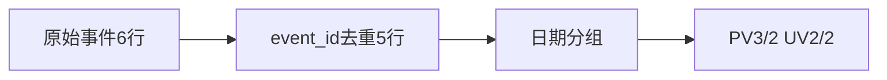

# 32 SQL入门、窗口函数与完整练习

## 先在合成小表上学会手算

SQL先明确一行代表什么，再决定GROUP BY、Join和窗口。下面使用Python自带SQLite内存库，进程结束自动释放，不连接项目生产库、Doris或业务MySQL。复制完整脚本保存到`runtime/handbook-sql.py`后，在仓库运行`uv run python runtime/handbook-sql.py`即可。不要把示例DDL粘贴到未知数据库会话。

```python
import sqlite3

db = sqlite3.connect(":memory:")
db.row_factory = sqlite3.Row
db.executescript("""
CREATE TABLE events(
  event_id TEXT, user_id TEXT, day TEXT,
  at_s INTEGER, page TEXT, accepted_seq INTEGER
);
INSERT INTO events VALUES
 ('e1','u1','2026-01-01',0,'/',1),
 ('e2','u1','2026-01-01',600,'/projects/',2),
 ('e2','u1','2026-01-01',600,'/projects/',3),
 ('e3','u2','2026-01-01',900,'/',4),
 ('e4','u1','2026-01-02',86400,'/',5),
 ('e5','u3','2026-01-02',87000,'/',6);
""")
query = """
WITH ranked AS (
 SELECT *, ROW_NUMBER() OVER (
   PARTITION BY event_id ORDER BY accepted_seq
 ) AS rn FROM events
), valid AS (SELECT * FROM ranked WHERE rn=1)
SELECT day, COUNT(*) AS pv, COUNT(DISTINCT user_id) AS uv
FROM valid GROUP BY day ORDER BY day
"""
for row in db.execute(query):
    print(dict(row))
db.close()
```

预期输出1月1日PV3、UV2，1月2日PV2、UV2。整个区间独立匿名用户只有u1/u2/u3共3个，不能把每日UV2+2说成区间UV4。示例u1等是教学合成标识，生产不会使用这些明文名称。

## SELECT的思考顺序

从FROM理解数据源，WHERE过滤行，GROUP BY分组，HAVING过滤分组，SELECT形成结果，ORDER BY排序。窗口函数为每行增加上下文，不像GROUP BY直接折叠行。执行引擎可以改变物理顺序，但逻辑语义必须保持。

COUNT(*)数行；COUNT(column)不计NULL；COUNT(DISTINCT column)数非空不同值。左连接没有匹配时会产生右侧NULL，不能直接用COUNT(*)数匹配请求，应数匹配主键或条件SUM。



## 练习1：重复事件诊断

题：找出重复event_id以及额外副本数量。

```sql
SELECT event_id, COUNT(*) AS raw_rows, COUNT(*)-1 AS extra_copies
FROM events
GROUP BY event_id
HAVING COUNT(*) > 1;
```

答案：e2，raw_rows=2，extra_copies=1。若同event_id内容不同，真实系统还需比较规范化payload并隔离冲突，不能像练习这样一律挑第一条。选取顺序必须确定，只有ORDER BY at_s在时间相同情况下可能不稳定，因此使用单调accepted_seq。

## 练习2：每页热度与Join放大

在去重CTE后按page分组，首页PV4、UV3，projects页PV1、UV1。同一用户看多个页面时，各页UV相加不等于站点UV。若pages维表同一个page_id存在两个版本，直接按page_id连接会让事实变两行；SCD2必须增加发生时间落在有效区间的条件。

```sql
-- 这段是区间连接的模式，dim_pages需按实际模型创建。
SELECT f.event_id, d.category
FROM valid_events f
JOIN dim_pages d ON f.page=d.page
 AND f.occurred_at>=d.valid_from
 AND (d.valid_to IS NULL OR f.occurred_at<d.valid_to);
```

使用左闭右开区间能让变更瞬间只匹配新版本。请先验证同一page的区间不重叠，否则即使SQL看起来合理仍会放大事实。

## 练习3：30分钟会话断点

思路是先LAG得到上次事件，识别断点，再对断点做累计SUM生成分组。以下作用于前面的valid去重CTE后：

```sql
WITH ranked AS (
 SELECT *, ROW_NUMBER() OVER(PARTITION BY event_id ORDER BY accepted_seq) rn
 FROM events
), valid AS (SELECT * FROM ranked WHERE rn=1),
lagged AS (
 SELECT *, LAG(at_s) OVER(PARTITION BY user_id ORDER BY at_s,event_id) prev_s
 FROM valid
), marked AS (
 SELECT *, CASE WHEN prev_s IS NULL OR at_s-prev_s>=1800 THEN 1 ELSE 0 END new_session
 FROM lagged
)
SELECT event_id,user_id,at_s,
 SUM(new_session) OVER(
   PARTITION BY user_id ORDER BY at_s,event_id
   ROWS BETWEEN UNBOUNDED PRECEDING AND CURRENT ROW
 ) session_number
FROM marked ORDER BY user_id,at_s,event_id;
```

这里将恰好1800秒视为新会话，必须与你采用的契约边界一致。u1的e1/e2属于会话1，e4属于会话2；u2/u3各1个会话。真实项目按应用和匿名标识一起分区，不能跨应用合并。

## 练习4：次日留存

先按user_id求最早观察日期，再检查次日是否有活动。示例1月1日队列u1/u2，1月2日回来u1，D1=1/2。1月2日新用户u3的D1需观察1月3日，当前输入未覆盖该日，结果是未成熟而非0%。答案必须同时给cohort人数、eligible和retained；没有资格的分母不能硬填成队列总人数。

```sql
WITH user_days AS (SELECT DISTINCT user_id,day FROM events),
cohort AS (SELECT user_id,MIN(day) cohort_day FROM user_days GROUP BY user_id)
SELECT c.cohort_day,COUNT(*) cohort_users,
 SUM(CASE WHEN n.user_id IS NOT NULL THEN 1 ELSE 0 END) retained_d1
FROM cohort c LEFT JOIN user_days n
 ON n.user_id=c.user_id AND n.day=date(c.cohort_day,'+1 day')
WHERE c.cohort_day <= '2026-01-01'
GROUP BY c.cohort_day;
```

WHERE里的日期是本例明确的完整观察上限；在真实流水线中由coverage清单决定，不能仅取有事件的最大日期，因为无活动日可能完整，也可能采集断了。

## 排查与进阶练习

结果翻倍先检查Join基数和主键唯一性；UV异常低查NULL和匿名标识有效性；日期错一天查UTC到香港转换位置；窗口结果不稳定查ORDER BY是否有并列。下一步把同一练习改成Spark SQL，保留手算结果作对照；语法迁移时注意日期函数、时间戳类型与空值排序差异。

## 对照源码与项目证据

- [warehouse/spark/behavior.py](../../warehouse/spark/behavior.py)
- [warehouse/spark/batch.py](../../warehouse/spark/batch.py)
- [src/snow_statistics/model.py](../../src/snow_statistics/model.py)
- [tests/test_behavior.py](../../tests/test_behavior.py)
- [tests/test_lite.py](../../tests/test_lite.py)

[返回学习目录](00-阅读地图与当前状态.md)
