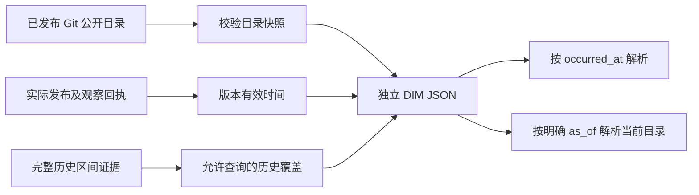

# 公开页面与角色目录维度：独立 SCD2 候选

本模块把两个产品已经发布的公开页面路径、角色选择 ID 做成独立版本维度。当前交付是纯 Python 构建、内存解析和只读 SQL 候选，**不表示真实 DIM Hive 表、Spark Join 或历史 SCD2 已在虚拟机验收**。现有 daily/behavior 指标、原始事件契约、真实作业 permit、冻结 writer 和保留期都不改动。

## 输入边界与时间含义

目录复用 [public_catalog.py](../src/snow_statistics/public_catalog.py) 的版本快照校验。该工具只从两个产品固定的 Git 文件读取允许公开的路径/角色 ID；不执行产品 JavaScript，也不复制完整角色设定。`stage=published` 本身只是发布声明，不能代替实际部署回执。

新的 [public_dimensions.py](../src/snow_statistics/public_dimensions.py) 接受三个层次的材料：

| 输入 | 说明 | 缺少证据时 |
|---|---|---|
| `snapshots` | 已发布目录、完整 Git SHA、目录哈希、声明的发布时间 | 不接受候选目录冒充正式目录 |
| `attestations` | 每个 snapshot/app 的核验记录：实际 `effective_at`、发布回执哈希、`observed_at`、`checked_through`、观察回执哈希 | 无法核实实际发布时间，设 `effective_at` 和发布回执为 `null`；只支持观察区间内的当前目录查询 |
| `coverage` | 某个版本在 `[covered_from, covered_to)` 内持续生效的完整历史证据；包含 `verified_at` 和回执哈希 | 区间不存在即 `unknown`，不把两个时间点观察当作中间持续有效的证明 |

这些证据哈希是**需要操作者先审阅原件的引用**。模块校验引用格式、目录内容和时间一致性，并不凭一个哈希证明服务器真的发布过该版本；也不联网验证 Cloudflare 或 GitHub。正式运行前，操作者必须核对原回执内容与哈希。观察到网站显示某个 SHA 的时间，不一定就是切流时间；不得用观察时间填补未知的实际上线时间。

`knowledge_cutoff` 是本次材料已知的截止时间，不能默认用当前电脑时间扩展覆盖。`checked_through` 只有在证据能证明同一目录从观察开始持续有效时才能比 `observed_at` 更晚。仅一次探测就把二者设为相同时间。晚到事件始终使用事件的 `occurred_at` 做历史查询。

真实和合成由输入 `source` 和独立输出目录分开。此模块处理的全部内容都是公开目录元数据；给一个合成示例改 `source` 并不能使其成为已经核验的真实发布证据。真实事实接入仍须走原受控入口和 permit。

## 产物与查询语义



`dimensions.json` 包含规范化输入、`releases`、`observations`、`coverage`、`dimensions` 和内容摘要 `artifact_id`。只包含公开页面/角色键、版本和证据引用，不保存事件、匿名标识、请求 ID 或聊天。重复输入和输入顺序不改变物化表及产物 ID；新增真实观察/证据属于新的产物，不覆盖旧产物。

- `valid_from` 始终来自已核实的实际发布时刻，未知就保持 `null`。
- `valid_to` 只有在明确历史证据延伸到已核实的后继发布边界时才闭合。`null` 表示尚无可靠关闭边界，**不表示无限期有效**。历史 Join 必须先命中 `coverage`，不能只用 `valid_from <= t AND valid_to IS NULL`。
- 历史缺口、首次有证据之前、资料截止之后都返回 `unknown`。
- 目录键从新版本移除时保留 `present=false` 的墓碑行。`not_present` 表示已知该时刻的完整目录中没有此键；它与无法确定目录的 `unknown` 不同。
- 当前查询必须显式给 `as_of`，并落在某份证据的闭区间 `[observed_at, checked_through]` 内。不会因为最后一个版本没有后继版本就默认有效到现在。
- 相同 SHA 改变目录、同刻互相冲突的发布、历史区间穿过其他已知发布或矛盾观察，均拒绝构建；不会任选一个版本继续。

## Windows：可直接复现的合成操作

前提：仓库已有 Python 3.12 虚拟环境及锁定依赖。以下均在 **Windows PowerShell**、仓库根目录执行，不启动 VM、不联网，也不写 real 目录。

```powershell
Set-Location 'C:/Users/25685/Desktop/Myprojects/Snow_Statistics'
& .venv/Scripts/python.exe tools/public_dimensions.py
& .venv/Scripts/python.exe tools/public_dimensions.py --check --input examples/public-dimensions.synthetic.json
& .venv/Scripts/python.exe -m pytest tests/test_public_dimensions.py -q
& .venv/Scripts/python.exe tools/public_dimensions.py --execute --input examples/public-dimensions.synthetic.json
```

默认命令只说明操作，不读取输入；`--check` 校验但不写文件；`--execute` 才会创建 `runtime/public-dimensions/synthetic/<artifact_id>/dimensions.json` 和 `manifest.json`。它不创建任何服务或定时任务。

同一产物已经存在时再次执行会明确拒绝覆盖。先使用 `--check` 取得期望 ID，检查已有文件并调用 `validate_bundle` 重算内容即可；不需要重新生成。执行中断时可能留下不完整的新目录，不能把目录存在当成成功，应核验两份文件。不要自动删除目录或覆盖旧证据。

独立内存查询示例仍只使用合成文件。在同一个 **Windows PowerShell / 仓库根目录** 执行：

```powershell
@'
import json
from pathlib import Path
from snow_statistics.public_dimensions import DimensionIndex, build_bundle
spec = json.loads(Path("examples/public-dimensions.synthetic.json").read_text(encoding="utf-8"))
index = DimensionIndex(build_bundle(spec))
projection = {"source": "synthetic", "app": "project_snow",
              "occurred_at": "2026-01-01T02:00:00Z", "character_id": "old-role"}
print(json.dumps(index.resolve_fact(projection, current_as_of="2026-01-04T00:00:00Z"), indent=2))
'@ | & .venv/Scripts/python.exe -B -
```

预期历史结果为 `present`，当前结果为 `not_present`。结果只包含 DIM 状态和维度/版本键，不回显角色键、事件时间或身份。调用方只能在内存提供白名单投影；完整事件信封、匿名 ID、request_id 等多余字段会被拒绝。这个 API 不替调用方保存事实，也不会把此结果自动写入真实报表。

## 正式材料准备与下一实际阶段

1. 在宿主机读取两个产品**已发布的精确 Git 提交**，生成并验证公开目录快照；保留对应真实部署回执。公开 Git 提交时间不是上线时间。
2. 从原回执逐一核实 `release_sha`、实际上线时间和目录内容；填写 `attestations`。只有声明、没有实际上线证据时保持 `effective_at=null`，不能为了补齐 DIM 写入推测时间。
3. 为已经核实的完整发布历史区间填写 `coverage`。只有当前探测结果时，可以提供点观察而保持 `coverage=[]`；此时当前点可解析，历史解析全部未知，这是合格的保守结果。
4. 把 real 材料置于本项目 ignored runtime 的独立目录，用 `--check` 审查，随后显式 `--execute` 生成 `runtime/public-dimensions/real/<artifact_id>/`。先确认该源码已经完成计划中的签名来源安装；不要把宿主机未安装的新模块误说成 VM 已具备。
5. 后续单独阶段在受控、同来源、有效期内的事实窗口生成临时投影，并把 DIM 的 `coverage` 和 `dimensions` 装成独立视图。现有真实作业没有这个输入字段，本次没有修改其配置或 permit。
6. [public_dimensions_at_event.sql](../warehouse/spark/public_dimensions_at_event.sql) 给出只读 Join。未来实际 Spark/Hive阶段需固定三份视图 `public_dim_fact_projection`、`public_dim_coverage`、`public_dim_scd2`；`fact_ordinal` 只是当次临时序号，不能换成用户/事件/请求 ID。事实时间先转为产物同格式的 UTC 六位小数字符串；并在 Join 前验证同来源、唯一临时序号、路径/角色字段允许范围。此 SQL 自身不是导入器或权限边界。
7. 先用合成样例对照 Python 结果、记录实际 Spark/Hive 版本与执行计划，再允许真实受控投影采样核验。只有实际跑过才记录引擎验收、表名、输入摘要、行数及覆盖；本轮只完成了 SQLite 合成 SQL 对照。

此 DIM 是公开元数据，不含真实匿名明细，按公开目录元数据规则保留。未来 Join 产生的事实/辅助输出仍继承原事实期限；不能因加入维度而延长 raw 7 天或辅助 30 天期限，也不能把真实 Join 输出写进这个不含事实的元数据目录。

## 手算与失败处理

合成例子：版本 1 在 1 月 1 日生效，目录含 `/old`、`old-role`；版本 2 在 1 月 3 日生效并移除两者，新增 `/new`、`new-role`。历史证据只覆盖 `[1日,2日)` 与 `[3日,5日)`。

| 查询 | 正确结果 | 原因 |
|---|---|---|
| 1 日 `/old` | present | 命中版本 1 与历史覆盖 |
| 2 日 `/old` | unknown | 已知版本之间存在历史证据缺口 |
| 3 日 `/old` | not_present | 版本 2 的删除墓碑 |
| 3 日 `/new` | present | 半开边界归于新版本 |
| 5 日历史 `/new` | unknown | 历史覆盖的右端不包含在内 |
| 5 日“当前” `/new` | present | 当前观察闭区间包含该明确截止点 |
| 5 日之后“当前” `/new` | unknown | 不能超出已核验的观察覆盖 |

常见失败：时间缺少时区则补齐原始证据的真实时区；区间冲突则回查发布回执并缩小覆盖，不放宽校验；某键返回未知则先判断目录覆盖是否存在，再检查键是否在目录中；真实材料只有候选目录时应等待实际发布证据。任何失败都不修改线上采集和现有指标。

练习与答案：把版本 1 的历史覆盖右端改到 3 日，并保持历史核验时间在其后，会填入可靠的 `valid_to=3日`，2 日 `/old` 变为 present；这必须有完整历史证据，不能仅修改示例参数就声称生产历史已补齐。面试追问“为什么不能直接用最新目录 Join 历史事实？”——这样会把角色下架、页面改版后的归属倒灌进过去；本项目保留发生时与当前两种查询，而且显式保留未知覆盖。
