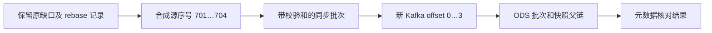

# Rebase 后的真实输入前缀检查

`src/snow_statistics/real_prefix.py` 提供 `validate_rebased_prefix`。它只核对已有元数据的一致性，不连接 Kafka、Doris、HDFS 或线上采集器，不读取事件、不写文件、不签发许可。其返回结果属于私有运行元数据，应存放在忽略的 `runtime/real/` 中。

下面使用合成数字说明：一次显式恢复可能把采集器位点从旧的不可读窗口跳到 `after=700`；新 lane 从 `701` 开始接收。同时，新 Kafka Topic 的第一个 offset 仍是 `0`。两套位点不能互相替代，也不能把旧的“从采集器 0 开始”检查直接复制到新 lane。



## 输入来自哪些实际文件

函数不规定新的生产文件格式，而是接收现有写入器产生的对象：

| 参数 | 实际来源与要求 |
|---|---|
| `config` | 当前 lane 的 `real_lab` 配置；必须 `input_origin=real` |
| `registration` | 调用方实际通过 `WriterRegistry.ready()` 取得的注册信息；函数不代替该检查 |
| `source / target / cursor / rebase` | 同步目录已有的四个同名 JSON 文件 |
| `status` | 一次固定、经过 reader token 认证的源状态观察；`latest_accepted_seq` 是本次目标 |
| `sync_manifests` | `{batches/<first>-<last>.json: 对应 .manifest.json 内容}`；沿用 `archive / sha256 / after` 字段 |
| `lifecycle_artifacts` | 同步目录 `data/registry.json` 的 `artifacts`，包括批次和 companion 的登记 |
| `archive_checksums` | 对相同批次名称逐一计算得到的实际 SHA-256；必须在生命周期允许读取后取得 |
| `ods_state / ods_landed` | 同一 ODS 目录的 `state.json / landed.json`，内容必须一致 |
| `ods_manifests` | `{batch_id: batches/<batch_id>/manifest.json 内容}` |
| `now` | 带时区的实际当前时间，用于检查原始保留期限 |

函数检查源代际、新旧 lane、固定源位点、同步归档区间、原始接收期限、归档哈希、ODS 身份、各批次父快照、单输入分区、初始 Kafka offset 和最终快照一致性。它要求同步游标恰好等于固定目标；若已同步到更晚位置，应重新观察并明确选择新的目标，不能把后来的快照套进旧证据。

## 调用前后仍必须做什么

在受控 Linux VM 的当前项目目录执行实际操作时，调用方负责以下步骤；这些步骤不是给函数传入一个“通过”标志即可替代的：

1. 核验源码和当前 writer 注册，按原有锁与生命周期入口执行必要清理。检查同步 `pending.json`、未解决的 `gap.json`、ODS `pending.json / cleanup.json`，保留原 rebase 缺口历史。
2. 在固定的受控观察期间读取上述元数据。使用 `RealLifecycle.readable()` 等已有入口核验所有权、文件清单和到期状态，然后对实际归档字节计算哈希。函数的纯元数据接口不能判断调用者是否真的读取了这些字节。
3. 调用 `validate_rebased_prefix(...)`，保留结果与来源文件的摘要。错误应终止这次登记，不能清空历史记录以绕过检查。
4. 分别读取实际 HDFS 文件哈希及副本位置、Kafka 集群与 Topic 身份及 committed offset，完成存储验收。`state == landed` 只说明本地回执一致，不代表此刻 Kafka 已独立读回。
5. 用同一输入范围做事件／请求去重和整数指标对账。Kafka 重放可以产生更多物理记录，因此函数允许 Kafka 记录数大于源序号数，但始终返回 `payload_equivalence_verified=false`。载荷等价与业务去重需要独立核验。
6. 需要计算时，再通过公开 `prepare → cleanup/permit → stage-compute → daily/behavior` 流程实际签发并验证许可。函数始终返回 `read_permission=false`，没有替代许可的路径。

## 接收时间、业务日期与自然闭日

`accepted_at` 是采集器接收时间，用于原始数据保留期限和固定输入截止；业务日期来自事件 `occurred_at` 按香港时区转换。**今天收到的事件可能发生于昨天或更早。** 本函数不读取事件字段，因此不输出 `date_from / date_to`，也不判断是否有可计算的闭日。必须通过实际受控输入与聚合结果确认业务日期。

已有真实 behavior 与发布校验器要求报表日期已经在真实 cutoff 时刻自然闭日。不能把未来 cutoff 写入任务来提前满足该约束。若当天尚未闭日，可以完成实时整数指标、同步、恢复、ODS 和 ACK 验收，但不能称为全天闭日报表。

登记后续作业时，使用实际 `state.input`；`coverage.continuous_from` 从已验证的新观察窗口起点开始，不能回填成午夜或旧 epoch 的开始时间。`coverage.through` 等于已发生的作业 cutoff，窗口之前的缺失保留在 rebase 旁证中。固定已提交前缀不等于事件时间 watermark，也不证明迟到事件以后不会到达。留存的前置覆盖或成熟期不足时维持 `pending/incomplete` 和空值；没有匿名行为时可能根本没有留存行。

## 验证范围

`tests/test_real_prefix.py` 只用合成事件，实际调用已有 `sync_once`、`capture`、`land` 和 `acknowledge` 产生元数据，再测试非零 rebase、源与 Kafka 位点区分、哈希／区间错误、过期与延寿、代际变化、重复记录及不完整链。测试特意令发生日期早于接收日期，防止把接收日期错误描述为业务日期。

在 Windows PowerShell、仓库根目录运行：

```powershell
.\.venv\Scripts\python.exe -m pytest tests/test_real_prefix.py -q
```

这些测试是函数及既有元数据协议的合成验证，不构成真实引擎、本轮 HDFS 或 Kafka ACK 的执行证据。
